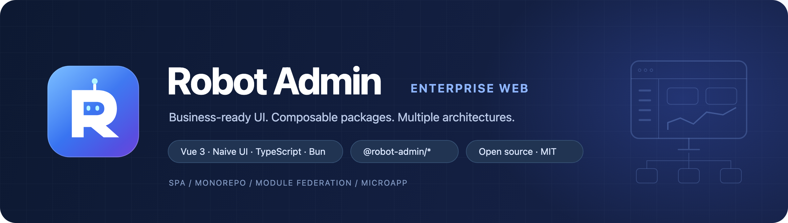
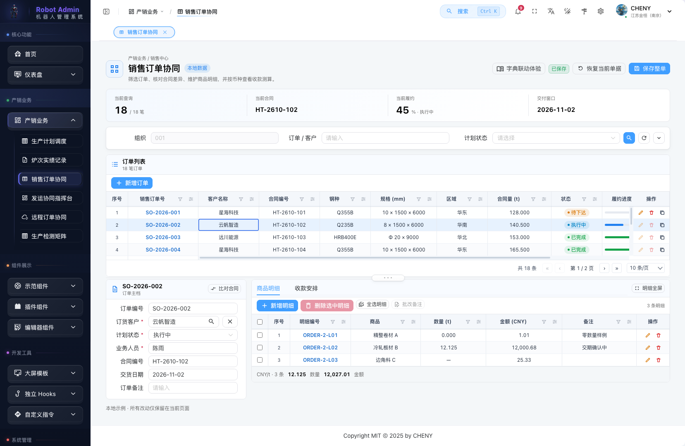
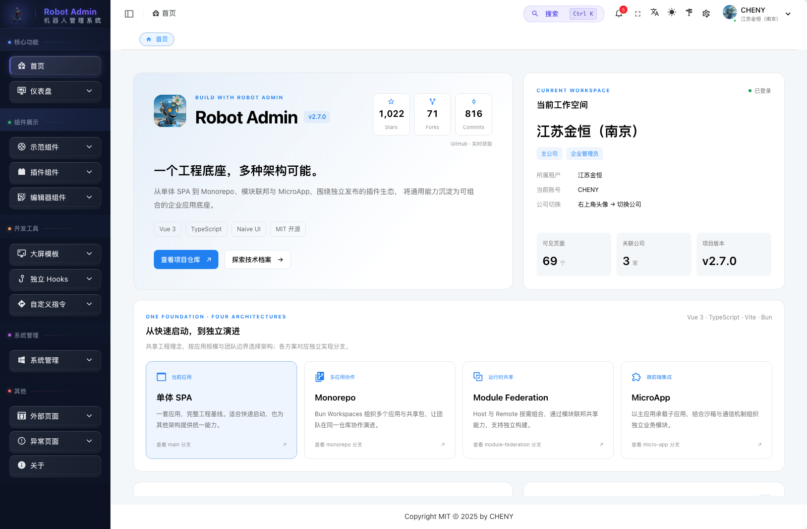
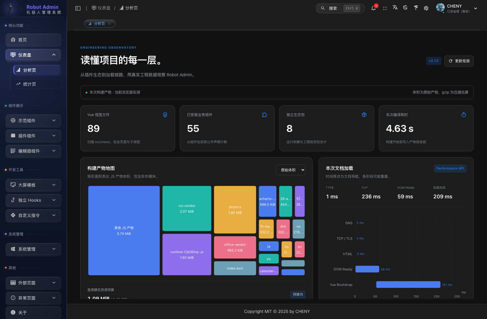
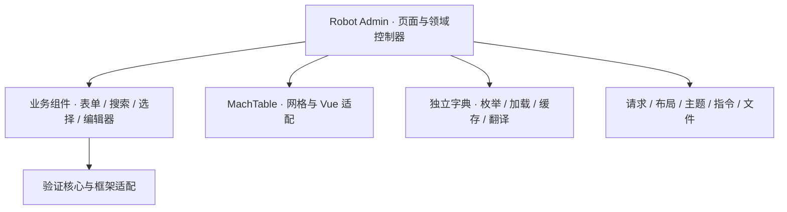

<!-- 封面源文件与导出方式：docs/assets/robot-admin-banner.svg · bun scripts/render-readme-banner.ts -->



<div align="center">
  <p><strong>一个工程底座，连接业务、组件与多种架构。</strong></p>
  <p>Vue 3 · TypeScript · Vite · Naive UI · UnoCSS · Bun</p>
  <p>
    <a href="https://robotadmin.cn">在线体验</a> ·
    <a href="https://www.tzagileteam.com">组件文档</a> ·
    <a href="#快速开始">快速开始</a> ·
    <a href="#场景体验">场景体验</a> ·
    <a href="#多架构选择">多架构</a> ·
    <a href="#插件生态">插件生态</a> ·
    <a href="./README_EN.md">English</a>
  </p>
  <p>
    <a href="https://github.com/ChenyCHENYU/Robot_Admin/actions/workflows/ci.yml"></a>
    <a href="./package.json"></a>
    <a href="./LICENSE"></a>
    <a href="#能力地图"></a>
    <a href="https://github.com/ChenyCHENYU/Robot_Admin"></a>
  </p>
</div>

## 项目定位

**Robot Admin** 是面向企业 PC 中后台的 Vue 3 工程模板，也是独立组件与插件的应用实践。页面定义业务模型、字段、接口和权限，通用的渲染、校验、加载、取消与交互由包实现。

当前单体主线 **v2.7.0** 包含多公司登录、系统治理、工程分析、使用统计，以及生产、销售、发运等复杂组合工作区。SPA、Monorepo、Module Federation、MicroApp 分支分别维护，按团队协作和部署边界选择。

| 维度     | 当前提供                                                                   |
| -------- | -------------------------------------------------------------------------- |
| 业务场景 | 6 个产销工作台；主从表、密集表单、动态报表、分组汇总与检测矩阵             |
| 组件生态 | 63 个业务组件、11 个指令；8 个运行时 `@robot-admin/*` 包 + 1 个 Git 工程包 |
| 示例入口 | 58 个演示页面，覆盖表单、搜索、选择、表格、树、流程、文件和媒体            |
| 工程保障 | 类型检查、双 Lint、逻辑与组件测试、构建预算、浏览器回归与构建身份          |

## 快速开始

需要 **Node.js ≥22.18.0**、**Bun ≥1.4.2**。依赖声明见 [package.json](./package.json)，实际安装版本由 [bun.lock](./bun.lock) 固定。

```bash
git clone https://github.com/ChenyCHENYU/Robot_Admin.git
cd Robot_Admin
bun install --frozen-lockfile
bun run dev
```

打开 **http://localhost:1988/**。国内代码镜像：[Gitee](https://gitee.com/ycyplus163/Robot_Admin)。

| 本地体验   | 说明                                                                    |
| ---------- | ----------------------------------------------------------------------- |
| 管理员账号 | `CHENY / 123456`，按页面提示完成人机验证                                |
| 公司选择   | 账号密码验证成功后选择授权公司，票据激活；单公司直接进入，登录后可切换  |
| 权限场景   | `STAFF` 演示单公司，`NOACCESS` 演示无授权公司；Mock 接受任意非空密码    |
| 网络访问   | `bun run dev` 默认 localhost；`bun run dev:ip` 自动显示本机和局域网地址 |

开发环境默认启用 Mock，公开演示站也使用明确的 `demo` 部署模式。真实业务通过 `application + remote` 接入后端，步骤见 [接入业务](#接入业务)。

## 能力地图

### 业务组件与数据交互

| 能力           | 已提供的行为                                                                                               | 从哪里开始                                                              |
| -------------- | ---------------------------------------------------------------------------------------------------------- | ----------------------------------------------------------------------- |
| 表单与弹窗     | 动态字段与规则、字段联动、网格/步骤/动态布局；异步校验、提交锁定、取消与草稿保护；紧凑模式保留完整错误提示 | [表单配置](./docs/form-configuration.md)                                |
| 搜索区         | 配置 3/4 列，随容器收拢；展开折叠、条件历史、字段设置、固定条件；搜索和重置共用查询入口                    | [搜索与选择](./docs/core-components.md#搜索与选择)                      |
| 日期与选项     | 日期/时间及范围、联动约束、远程选项、自由文本建议；多选标签、长文本收敛与清空语义                          | [组件体验入口](#组件与网格体验入口)                                     |
| 实体选择       | 分页检索、已选回显、确认/取消；在编辑表单内部选择客户，复用当前会话                                        | [销售订单实现](./src/views/production-sales/sales-orders/operations.ts) |
| 普通业务表格   | `C_Table`：配置列、CRUD 编辑、树/展开行、原生分页、序号、状态标签、内容适宽与行操作                        | [两种表格怎么选](#两种表格怎么选)                                       |
| 高密度数据网格 | MachTable：虚拟化、固定列、编辑、合并、选择、粘贴、拖拽排序、导入校验与完整快照输出                        | [MachTable 场景](./docs/core-components.md#machtable-场景)              |
| 字典与枚举     | 统一远程加载、去重缓存、类型保留、空数据/失败区分、局部重试；表单、搜索、列表、详情共享翻译                | [独立字典接入](./docs/dictionaries.md)                                  |
| 业务组合       | 主从联动、独立分页、分栏拖动、精确合计、跨区域校验定位、批改预览与部分失败重试                             | [产销业务场景](#产销业务场景)                                           |
| 编辑与流程     | 代码、Markdown、富文本、Cron 预览、公式试算、流程图与工作流节点配置                                        | [工作流示例](./src/views/demo/28-work-flow-editor/index.vue)            |
| 文件与展示     | Excel/CSV/ZIP、上传下载、预览、打印、签名裁剪、音视频、日历、时间线、甘特与图表                            | [在线体验](https://robotadmin.cn)                                       |

### 身份、工作空间与工程观测

| 领域           | 当前实现                                                                                                 |
| -------------- | -------------------------------------------------------------------------------------------------------- |
| 公司与会话     | 账号验证后激活授权公司，支持主/兼任公司、公司内角色及登录后切换                                          |
| 权限与治理     | 用户、角色、菜单、字典、动态路由、按钮权限、临时角色授权；按后端能力开放操作并检查并发版本               |
| 工作空间       | 6 种布局、亮/暗/跟随系统、多标签页、页面缓存、主题设置与功能引导                                         |
| 企业消息       | 共享收件箱、待办、模板、发送投递、审计与偏好；[本地演示及远端协议](./docs/enterprise-notifications.md)   |
| 工程与使用统计 | 当前仓库与构建分析、浏览器加载时间线、导航 PV、功能操作及耗时分位数；[统计口径](./docs/observability.md) |

公司切换会清理旧权限、动态路由、页签及页面缓存；身份代次阻止旧请求覆盖新会话。治理页的 Remote 写入范围由能力接口决定，字段权限与范围配置的演示不代表后端已提供相应写入能力。详见[企业认证](./docs/enterprise-auth.md)与[生产接入基线](./docs/production-readiness.md)。

## 场景体验

### 产销业务场景

「产销业务」菜单对应独立目录 [src/views/production-sales](./src/views/production-sales/)。以下六页均可在本地演示，无需业务后端。

| 页面 / 路由                                                                                                        | 可以实际操作的内容                                                                                        |
| ------------------------------------------------------------------------------------------------------------------ | --------------------------------------------------------------------------------------------------------- |
| [生产计划调度](./src/views/production-sales/production-plan/index.vue) · `/#/production-sales/production-plan`     | 产线树与计划/炉次主从表、进阶查询、产能负荷；新增、编辑、确认复制、删除、下达/撤销及同产线同浇次排序      |
| [炉次实绩记录](./src/views/production-sales/production-actual/index.vue) · `/#/production-sales/production-actual` | 密集数值录入、成分上下限核对、工序追踪；切炉草稿保护、保存/复核/退回、上一炉只读参考及并排小表            |
| [销售订单协同](./src/views/production-sales/sales-orders/index.vue) · `/#/production-sales/sales-orders`           | 可调上下区域、订单主档与商品/收款双明细、合同差异采纳、弹窗客户选择；精确合计、整单校验、批改和失败项重试 |
| [发运协同指挥台](./src/views/production-sales/shipping/index.vue) · `/#/production-sales/shipping`                 | C_Table 任务池、MachTable 库存匹配、车辆表单及分组汇总；重量守恒、超载拦截、装车锁定与确认出厂            |
| [远程订单协同](./src/views/production-sales/remote-workbench/index.vue) · `/#/production-sales/remote-workbench`   | 异步主从表独立分页/加载/重试，交付与质量方案动态返回列和数据；慢响应、失败、空明细及字典晚到演练          |
| [生产检测矩阵](./src/views/production-sales/production-matrix/index.vue) · `/#/production-sales/production-matrix` | 日期/班次分组、固定指标、数值与时间复合编辑、整批粘贴与撤销；隐藏日期保留修改，完整快照预览/CSV/XLSX/打印 |

业务列表默认带序号；编辑/删除位于固定行操作列，蓝色单号打开只读详情，点击行联动工作区。复制确认后才生成独立记录，取消不占编号；跨行编辑与切单继续经过保存/放弃/取消保护。操作按钮使用语义图标。

工作区支持桌面分栏、窄屏堆叠与矮屏滚动；表格内独立滚动，分页和底部横轨保持可达。订单、炉次与库存明细短内容随内容收起，长内容在上限内滚动。

这些页面使用明确标注的本地数据源；“远程订单协同”演示的是异步接口契约，不是已接通的生产订单服务。接入真实服务时由 API 层提供列描述、稳定行键、准确 `total` 与取消信号。原 `/#/demo/business-workbench` 跳转到销售页，免登录预览为 `/#/preview/production-sales/<页面路径>`。

### 组件与网格体验入口

| 场景        | 入口                                                           | 验证重点                                                                         |
| ----------- | -------------------------------------------------------------- | -------------------------------------------------------------------------------- |
| 表单 / 搜索 | `/#/demo/form-manage/form` · `/#/demo/form-manage/form-search` | 多布局、密度切换、动态规则、条件折叠、历史、多选与布尔原值                       |
| 日期 / 时间 | `/#/demo/date` · `/#/demo/time`                                | 单值、范围、格式化值、联动约束及单独/组合使用                                    |
| 树 / 分栏   | `/#/demo/tree` · `/#/demo/split-pane`                          | 受控选择、虚拟树、本地懒加载失败重试、嵌套三表与独立滚动                         |
| 超级表格    | `/#/demo/table-manage/table`                                   | 弹窗/行/单元格/混合编辑，密度、分页、序号与中文枚举显示                          |
| MachTable   | `/#/demo/table-manage/mach-table`                              | 标准 CRUD、单元格/整行编辑、数据工作台、树形、顺序调整、导入校验、千万行逻辑视口 |
| 字典联动    | 销售订单协同 →「字典联动体验」                                 | 共享请求、空字典、失败重试、作用域切换、`0/false/"0"/"001"` 与多选               |
| 工作流      | `/#/editor/work-flow-editor`                                   | 节点配置、审批方式、条件、只读预览、本机草稿及导出                               |

演示目录包含 **58 个演示页 + 8 个表单布局 + 3 个页内组件（69 个 index.vue）**，与产销六页分别计数。更多交互入口和组合写法见[当前组件接入指南](./docs/core-components.md)。

MachTable 的「顺序调整」提供多项拖动、键盘移动、撤销/重做及本地保存失败/版本冲突演练。「导入校验」先预览规范值和逐行问题，再确认导入。「千万行视口」使用按块生成的逻辑数据源，每次生成 200 行、最多缓存 8 块，不预先创建千万行数组。

### 页面预览

[](docs/assets/production-sales-workspace.png)

<details>
<summary>首页与深色工程分析</summary>

|                                       工作空间 · 浅色                                       |                                       工程分析 · 深色                                       |
| :-----------------------------------------------------------------------------------------: | :-----------------------------------------------------------------------------------------: |
| [](docs/assets/workspace-light.png) | [](docs/assets/analysis-dark.png) |

</details>

截图来自当前主线的本地 Mock 演示。在线站点的功能以其部署版本为准。

## 两种表格怎么选

| 场景                       | 使用入口                                | 页面提供                                             |
| -------------------------- | --------------------------------------- | ---------------------------------------------------- |
| 常规列表、CRUD、树与展开行 | `C_Table`                               | `columns` + `data`，按需提供 `config` 或 `crud`      |
| 大数据、宽表、高密度编辑   | MachTable，默认 `preset="list"`，可省略 | `column-defs` + `row-data` 或公开数据源              |
| 详情、同屏多张只读小表     | MachTable `preset="detail"`             | 列和数据；纯文字表头、有界自动高度，无需重复关闭工具 |

```vue
<C_Table :columns="columns" :data="rows" />
<MachTable :column-defs="columnDefs" :row-data="rows" />
<MachTable
  preset="detail"
  :column-defs="detailColumns"
  :row-data="detailRows"
/>
```

示例使用本项目已安装的自动导入与异步网格插件。两类表格各用自己的列协议和分页条，默认显示序号、普通及数值列居中；`pagination`、`row-number` 均可显式关闭，`detail` 场景已有相应默认值。

- **适宽与调宽**：未显式定宽的业务列按完整表头与有界显示内容测宽，余量按基准比例分配；序号/选择/操作列保持紧凑。拖动只改变目标列，表头文字和控件构成下限；正文独立省略并可查看完整值。保存手动宽度不改变列的原始展示规则。
- **高度与主题**：完整列表在工作区内部滚动；短明细随内容收起，超过上限后滚动。保留两种表格各自主题与空态，不由页面重复绘制。状态标签、普通枚举和关键数值分别配置，可覆盖语义色与显示规则。
- **紧凑默认值**：MachTable 的 `size: 'compact'` 默认正文 30px、表头 34px，显式 `rowHeight/headerHeight` 优先。`C_Table` 注入 `density: 'compact'`，行高依按钮、编辑器和内容展开，局部密度及控件尺寸可覆盖。主按钮文字/图标与 Checkbox 勾在明暗主题中默认白色；局部 `NConfigProvider` 可用 `createComponentTheme({ onSolid })` 覆盖实色背景上的前景。
- **动态数据**：接口层映射到各自公开列定义；远程示例将列与行作为同一查询结果提交，旧响应不会覆盖新方案。字典更新仅刷新显示，不必重查业务数据。
- **跨页选择**：MachTable 查询全选后，`selectedRows` 只保留最近成功页面的选中行快照；跨页批量操作使用查询与 `selectionState`，排除 ID 跨页保留。
- **个人偏好**：启用 `persistKey/persistence` 的表格按租户、公司、用户与表格隔离；身份未就绪时暂停存储。C_Table 全局范围只配置一次，MachTable 在 setup 捕获范围并由布局在身份切换时重建实例。B 首次使用显示默认值，切回 A 恢复 A；A 的延迟保存仍归属 A。现有体验入口为发运任务池和 MachTable 演示。

动态报表把稳定报表/列方案 ID 纳入偏好键；owner/key 管理偏好读写归属，选择属于查询与行身份，dirty 属于编辑草稿。切换偏好键不会自动清空后两者，页面仍需按业务边界处理选择重置及未保存保护。

公共外观在 [MachTable 配置](./src/config/mach-table.ts) 与 [组件插件](./src/plugins/naive-ui-plugin.ts) 集中提供；表单/搜索、字典和表格的组合见[接入指南](./docs/core-components.md)。

## 多架构选择

根据**代码协作方式与部署边界**选择架构。四种方案维护在独立分支，各自具有配置、入口与验证命令。

| 架构                  | 当前结构与机制                                                   | 适用场景                                 | 代码与接入指南                                                                                                                                                                     |
| --------------------- | ---------------------------------------------------------------- | ---------------------------------------- | ---------------------------------------------------------------------------------------------------------------------------------------------------------------------------------- |
| **SPA**               | 当前主线：单应用、动态权限路由、独立 npm 生态包                  | 单一中后台、团队模板、业务交付起点       | [`main`](https://github.com/ChenyCHENYU/Robot_Admin/tree/main) · 本文档                                                                                                            |
| **Monorepo**          | Bun Workspaces；`admin-internal` / `admin-saas` 应用与共享配置包 | 多产品共仓库维护、复用配置、分别构建部署 | [`monorepo`](https://github.com/ChenyCHENYU/Robot_Admin/tree/monorepo) · [升级指南](https://github.com/ChenyCHENYU/Robot_Admin/blob/monorepo/docs/MONOREPO_UPGRADE.md)             |
| **Module Federation** | 独立 `remoteEntry.js` 产物、Vue 桥接、物流消费端与联调验证       | 运行时消费远程模块、拆分发布边界         | [`module-federation`](https://github.com/ChenyCHENYU/Robot_Admin/tree/module-federation) · [分支说明](https://github.com/ChenyCHENYU/Robot_Admin/blob/module-federation/README.md) |
| **MicroApp**          | 门户与独立子应用、iframe 沙箱、主题与上下文通信                  | 已有系统接入门户、多团队独立维护         | [`micro-app`](https://github.com/ChenyCHENYU/Robot_Admin/tree/micro-app) · [升级指南](https://github.com/ChenyCHENYU/Robot_Admin/blob/micro-app/docs/MICRO_APP_UPGRADE.md)         |

分支的依赖与功能版本以各自清单为准，切换架构需要按对应指南接入与验收。Monorepo 的 SaaS 应用目前是架构演示壳层；`systemApp / public / template` 平台分层是[后续演进计划](./docs/module-federation-platform-plan.md)，与已存在的模块联邦分支分别说明。

## 插件生态

独立包提供公开 API，应用在配置与领域控制器中组合。字典向应用提供普通选项和翻译函数，表单与表格不识别字典实例或业务字典码。



以下是**本项目锁定的接入版本**，完整 API 与上游能力以各包文档为准。

| 包                                                                                                   | 接入版本 | 核心能力                                                   | 在项目中的职责                         |
| ---------------------------------------------------------------------------------------------------- | -------- | ---------------------------------------------------------- | -------------------------------------- |
| [`@robot-admin/naive-ui-components`](https://www.npmjs.com/package/@robot-admin/naive-ui-components) | `0.40.1` | 63 个业务组件、子路径加载、自动导入 Resolver、独立样式入口 | 表单、表格、菜单、编辑器和全局反馈     |
| [`@robot-admin/dictionary`](https://www.npmjs.com/package/@robot-admin/dictionary)                   | `0.6.1`  | 静态枚举、远程字典、隔离缓存及详情字段绑定                 | 表单、搜索、详情与两种表格共享翻译     |
| [`@robot-admin/request-core`](https://www.npmjs.com/package/@robot-admin/request-core)               | `0.7.0`  | 实例化请求编排、认证恢复、取消与 Headless CRUD             | 类型化 API、会话一致性、列表与编辑状态 |
| [`@robot-admin/form-validate`](https://www.npmjs.com/package/@robot-admin/form-validate)             | `3.4.4`  | 规则核心、组合与批量校验、Naive UI / Element Plus 适配     | 已内置于 `C_Form`，页面直接配置规则    |
| [`@robot-admin/layout`](https://www.npmjs.com/package/@robot-admin/layout)                           | `3.3.3`  | 6 种布局、框架无关设置协议、Vue Headless 与 Naive 入口     | 宿主提供菜单、路由和插槽，布局由包实现 |
| [`@robot-admin/theme`](https://www.npmjs.com/package/@robot-admin/theme)                             | `0.6.1`  | 主题核心、Vue 状态、Naive UI 适配、亮／暗／跟随系统        | 统一组件外观与主题状态                 |
| [`@robot-admin/directives`](https://www.npmjs.com/package/@robot-admin/directives)                   | `2.0.1`  | 11 个指令：权限、复制、拖拽、防抖、节流等                  | 声明式交互，组件卸载时回收资源         |
| [`@robot-admin/file-utils`](https://www.npmjs.com/package/@robot-admin/file-utils)                   | `3.0.4`  | 隔离实例、Excel / CSV / ZIP、可取消分片与文件处理          | 文件场景复用，按需加载重型依赖         |
| [`@robot-admin/git-standards`](https://www.npmjs.com/package/@robot-admin/git-standards)             | `1.0.5`  | 配置保护与 Git 工程标准                                    | 开发期提交规范与初始化工具             |

数据网格使用 **MachTable 0.42.0** · [`@agile-team/mach-table-vue`](https://www.npmjs.com/package/@agile-team/mach-table-vue)。Robot Admin 目前接入 Vue；Core、React、XLSX 及其他可选能力见 [MachTable](https://github.com/ChenyCHENYU/MachTable)。组件源码见 [naive-ui-components](https://github.com/ChenyCHENYU/naive-ui-components)，其余运行时包见 [robot-admin-packages](https://github.com/ChenyCHENYU/robot-admin-packages)。

## 工程机制与质量保障

| 机制           | 验证入口与边界                                                                                    |
| -------------- | ------------------------------------------------------------------------------------------------- |
| 配置与部署校验 | 校验环境、代理和部署用途；业务发布拒绝 Mock 与本地源码 alias                                      |
| 按需加载与缓存 | 路由分包、组件子路径、受网络/设备条件约束的预取；依赖清单变化后重启开发服务                       |
| 构建预算       | 入口、预加载、CSS、首屏合计、请求数量及最大异步块；`bun run check:bundle`                         |
| 类型与行为     | 双 Lint、样式边界、类型检查、Bun 逻辑测试和真实 Vue 组件挂载                                      |
| 页面回归       | 正式构建上的表格交互、明暗主题、窄/矮屏、tags 往返、账号/公司切换及实际绘制                       |
| 构建身份       | `/build-info.json` 记录版本、环境、部署类型、提交及构建时间；[溯源说明](./docs/build-identity.md) |

```bash
bun run verify                   # 双 Lint、样式、类型、逻辑/组件测试、双模式构建、预算
bunx playwright install chromium  # 首次安装浏览器
bun run test:e2e                  # 使用正式构建产物执行页面回归
```

[CI 配置](./.github/workflows/ci.yml)包含完整验证、依赖审计、浏览器与高 DPI 绘制检查。测试数量与测量结果对应具体提交和环境，不作为永久性能承诺；指标口径见[工程观测](./docs/observability.md)。

[AGENTS.md](./AGENTS.md) 与[编码指南](./.github/copilot-instructions.md)约束命名、目录、导入、样式和提交；7 个项目 Skill 覆盖开发流程。[MCP](./mcp/server.ts) 可通过 `bun run mcp` 查询组件 API、路由、接口与验证预设。

## 接入业务

### 1. 选择部署用途与数据模式

在未跟踪的 `envs/.env.local` 或目标部署环境配置：

```dotenv
VITE_DEPLOYMENT_PROFILE=application
VITE_AUTH_MODE=remote
VITE_DATA_MODE=remote
VITE_API_BASE=/api
# 本地需要代理时配置；部署后由同源网关提供 /api。
API_PROXY_TARGET=https://your-api.example.com
```

`bun run build` 默认生成公开演示产物 `dist/`；`bun run build:application` 生成业务预发验收产物 `dist/application/`。远端失败不回填演示数据，真实接口与网关按[生产接入基线](./docs/production-readiness.md)配置。

### 2. 对齐会话、资源与写入契约

| 场景       | 当前 Remote 契约                                                                                             |
| ---------- | ------------------------------------------------------------------------------------------------------------ |
| 多公司登录 | 验证账号密码后，单公司直接建立会话，多公司通过短时一次性票据激活；票据仅保留在页面内存                       |
| 菜单与授权 | 稳定 `robot-menu:${menuId}` 路由身份；无首页角色进入首个授权页，无菜单显示无访问权限；后端校验按钮与数据范围 |
| 并发写入   | 保留读模型 `revision`，按资源提交 `revision/expectedRevision`；冲突重新读取，不补取新版本后覆盖              |
| 临时角色   | 按角色、时间窗口和理由创建/撤销；UTC 传输、本地时间显示，撤销带读取时的版本                                  |
| 治理边界   | 能力接口决定可写项；数据范围、约束与审计当前只读，字段权限未接入，读取失败保持禁写                           |
| 个人账户   | Remote 保存昵称/邮箱/手机号；联系方式显式 `null` 清空。头像/简介及安全开关遵循当前只读边界，改密走专用接口   |

企业认证、成员与公司归属见[认证契约](./docs/enterprise-auth.md)；资源字段见 `src/api/*contract.ts`。与 [Robot Cloud](https://github.com/ChenyCHENYU/Robot_Cloud) 联调时保留双方构建身份及网关响应，验收版本冲突、撤权、停用成员和临时授权边界。

### 3. 接入统计与部署平台

访问统计默认是当前浏览器的本机样本；全站汇总需要配置同源采集/查询接口。Vercel Analytics / Speed Insights 仅在生产且显式启用时加载。仓库提供 [vercel.json](./vercel.json) 的路由回退与安全响应头，其他平台按[生产文档](./docs/production-readiness.md)提供等效部署配置。

## 国际化与设计系统

主题使用 CSS 变量和 Naive UI Provider，亮/暗/跟随系统与六种布局共享状态。语言支持 `zh-cn / en / ja / ko`，中文为源码，外语按当前词典加载；普通开发和生产构建不请求翻译服务。

新词条通过 `bun run i18n:generate` 显式生成并审核后提交；语言切换保留一次刷新以同步静态文案、菜单和页签。详见[国际化维护](./docs/internationalization.md)与[设计系统](./docs/design-system/README.md)。

## 技术栈与项目结构

精确版本对应当前锁文件；框架声明范围与完整依赖以 `package.json` 为准。

| 层级     | 当前技术                                                                                |
| -------- | --------------------------------------------------------------------------------------- |
| 应用     | **Vue 3.5.42** · **TypeScript 5.8.3** · **Pinia 4.0.3** · **Vue Router 5.3.1**          |
| 界面     | **Naive UI 2.45.3** · **UnoCSS 66.9.1** · **VueUse 14.4.0**                             |
| 构建     | **Vite 8.2.4** · Bun · Sass · 自动导入与按需组件 Resolver                               |
| 数据网格 | **MachTable 0.42.0** · Vue 适配层                                                       |
| 验证     | Oxlint / ESLint · vue-tsc · Bun Test · Vitest / Vue Test Utils / happy-dom · Playwright |

```text
Robot_Admin/
├── src/
│   ├── api/                 # 资源契约、Mock 适配与远端接口
│   ├── components/          # 全局宿主组件与局部业务组件
│   ├── composables/         # 登录、布局、缓存等应用组合逻辑
│   ├── config/              # Vite、主题、引导与观测配置
│   ├── constant/            # 应用共享常量
│   ├── plugins/             # 请求、布局、主题与观测初始化
│   ├── router/              # 动态权限路由与独立预览
│   ├── stores/              # 用户、权限、语言与设置状态
│   ├── styles/              # 全局入口与主题变量
│   ├── types/               # 应用与领域类型
│   ├── utils/               # 会话、路由、国际化与错误处理
│   └── views/               # 首页、分析统计、系统管理与场景演示
├── envs/                    # 环境与部署用途配置
├── lang/                    # 按语言拆分的扁平词典
├── patches/                 # 锁定版本的国际化插件适配
├── scripts/                 # 构建、样式、预算与分支同步
├── tests/                   # 逻辑、契约与组件挂载测试
├── e2e/                     # 生产产物的浏览器回归
├── mcp/                     # 项目事实查询工具
└── docs/                    # 接入、设计与维护文档
```

### 常用命令

| 目标                      | 命令                                                       |
| ------------------------- | ---------------------------------------------------------- |
| 标准开发 / 局域网访问     | `bun run dev` / `bun run dev:ip`                           |
| 安静启动 / Vue DevTools   | `bun run dev:quiet` / `bun run dev:devtools`               |
| 线上包类型检查            | `bun run type-build`                                       |
| 只读代码检查              | `bun run lint:check` + `bun run lint:eslint`               |
| 生产演示 / 业务预发构建   | `bun run build` / `bun run build:application`              |
| 产物预览 / 构建分析       | `bun run preview` / `bun run analyze`                      |
| 规范化提交                | `bun run commit`                                           |
| 功能分支同步至 dev / main | `bun run deploy`，先验证，再合并与推送；不升版本、不打标签 |

生态包源码联调、独立缓存、端口排查与更多命令见 [开发环境](./docs/development.md)。应用版本与正式日志由 Release Please 管理，历史变更集中在 [CHANGELOG.md](./CHANGELOG.md)。

## Robot 生态

同一品牌面向不同交付平台，各项目沿用适合自身平台的组件、工具链与接入契约。

| 项目                                                              | 定位                                         | 与 Robot Admin 的关系             |
| ----------------------------------------------------------------- | -------------------------------------------- | --------------------------------- |
| **Robot Admin**                                                   | 企业 PC 中后台、多架构工程与插件生态         | Web 管理端与公共 npm 包的应用实践 |
| [**Robot H5**](https://github.com/ChenyCHENYU/Robot_H5)           | Vue 企业移动应用，浏览器 / App / PDA WebView | 面向移动业务与宿主设备能力        |
| [**Robot UniApp**](https://github.com/ChenyCHENYU/Robot_uniApp)   | uni-app 跨平台应用，H5 / 微信小程序 / App    | 面向跨端页面与原生平台接入        |
| [**Robot H5 Core**](https://github.com/ChenyCHENYU/Robot_H5_Core) | 移动端设备能力与平台适配                     | 承接 H5 的浏览器与宿主能力边界    |
| [**Robot CLI**](https://github.com/ChenyCHENYU/robot-cli)         | 项目模板脚手架                               | 创建与初始化项目的工具入口        |
| [**AgileTeam Doc**](https://www.tzagileteam.com)                  | 团队工程与组件文档                           | 组件 API、实践说明与独立预览      |

封面沿用 Robot H5 的蓝紫 R / 机器人标识、深蓝网格和排版语言，使用本仓库的 SVG 源文件与高清 PNG，便于 GitHub、Gitee 和本地阅读。

## 文档与参与

| 主题                 | 入口                                                                                                                |
| -------------------- | ------------------------------------------------------------------------------------------------------------------- |
| 当前能力与组件组合   | [组件、搜索、表格与产销指南](./docs/core-components.md)                                                             |
| 字典、枚举与详情翻译 | [字典接入](./docs/dictionaries.md)                                                                                  |
| 表单、校验与异步提交 | [表单配置](./docs/form-configuration.md)                                                                            |
| 开发、源码联调与维护 | [开发环境](./docs/development.md) · [文档索引](./docs/README.md)                                                    |
| 真实业务接入         | [生产基线](./docs/production-readiness.md) · [认证](./docs/enterprise-auth.md) · [环境](./envs/README.md)           |
| 观测、构建与回归     | [观测](./docs/observability.md) · [构建身份](./docs/build-identity.md) · [运行时回归](./docs/runtime-regression.md) |
| 设计与协作           | [设计系统](./docs/design-system/README.md) · [贡献指南](./CONTRIBUTING.md) · [Agent 指南](./AGENTS.md)              |
| 历史变化             | [CHANGELOG](./CHANGELOG.md) · [Releases](https://github.com/ChenyCHENYU/Robot_Admin/releases)                       |

问题反馈请附路由、复现步骤、浏览器版本和构建身份：[GitHub Issues](https://github.com/ChenyCHENYU/Robot_Admin/issues)。作者：[CHENY](https://github.com/ChenyCHENYU) · [ycyplus@gmail.com](mailto:ycyplus@gmail.com)。

**MIT License**。允许商业使用与二次开发，请保留许可证及版权声明；依赖包遵循各自许可证。感谢 Vue、Vite、Naive UI、UnoCSS、Bun 及生态依赖的维护者。
