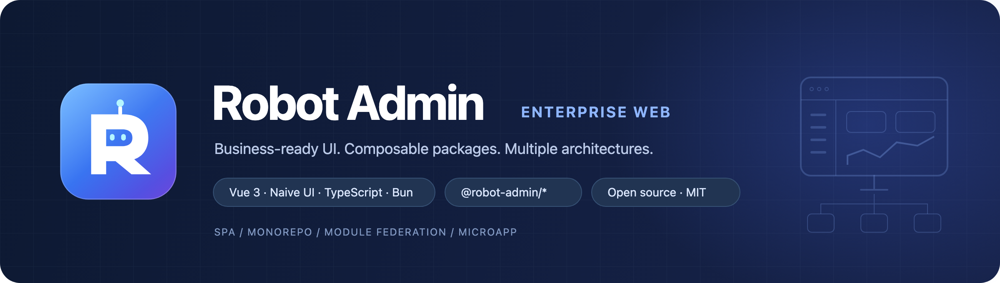
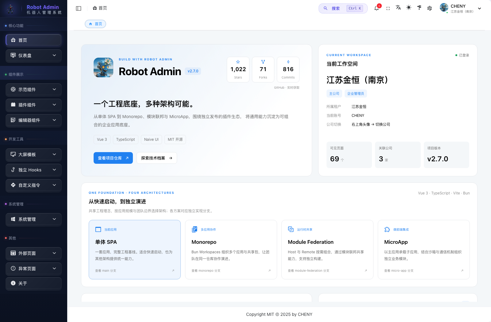
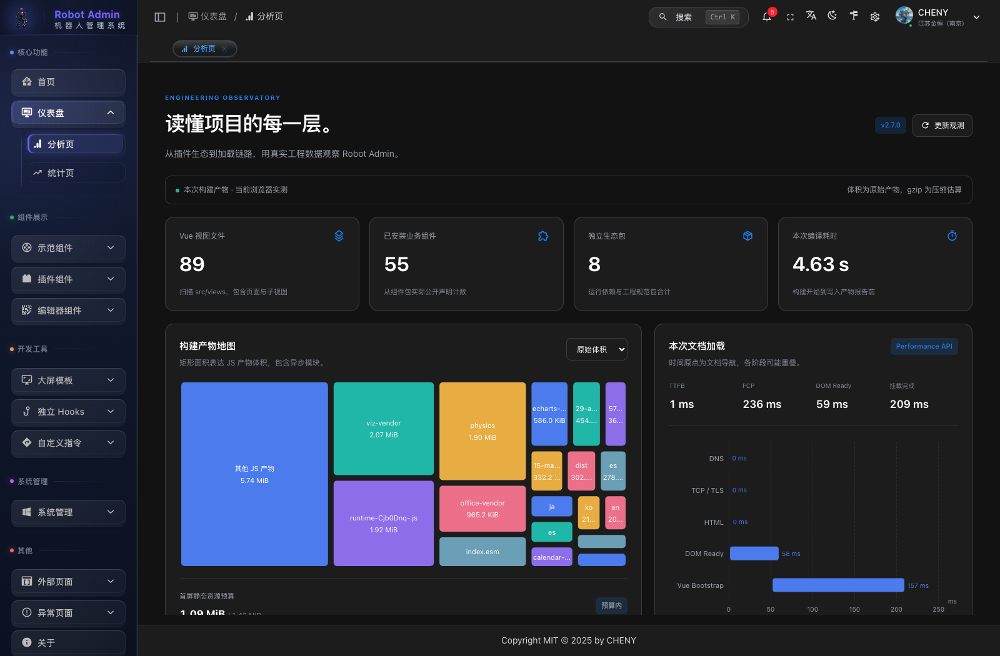
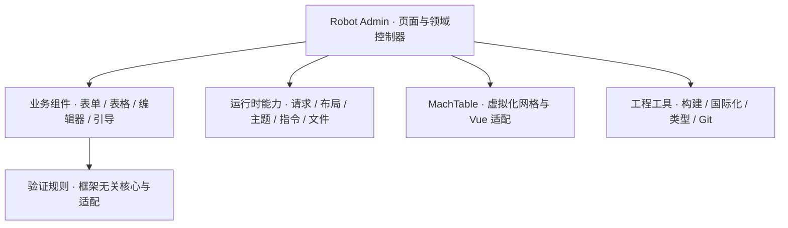

<!-- 封面源文件与导出方式：docs/assets/robot-admin-banner.svg · bun scripts/render-readme-banner.ts -->



<div align="center">
  <p><strong>一个工程底座，连接业务、组件与多种架构。</strong></p>
  <p>Vue 3 · TypeScript · Vite · Naive UI · UnoCSS · Bun</p>
  <p>
    <a href="https://robotadmin.cn">在线体验</a> ·
    <a href="https://www.tzagileteam.com">组件文档</a> ·
    <a href="#快速开始">快速开始</a> ·
    <a href="#多架构选择">多架构</a> ·
    <a href="#插件生态">插件生态</a> ·
    <a href="./README_EN.md">English</a>
  </p>
  <p>
    <a href="https://github.com/ChenyCHENYU/Robot_Admin/actions/workflows/ci.yml"></a>
    <a href="./package.json"></a>
    <a href="./LICENSE"></a>
    <a href="#能力地图"></a>
    <a href="https://github.com/ChenyCHENYU/Robot_Admin"></a>
  </p>
</div>

## 项目定位

**Robot Admin** 是面向企业中后台的 Vue 3 工程模板，也是 Robot 生态的 PC Web 应用入口。它把身份与权限、页面布局、表单表格、编辑器、工程验证沉淀为可组合的能力，应用负责业务配置，独立包负责可复用的实现。

当前单体主线 **v2.7.0** 提供公司上下文登录、系统管理、工程分析与访问统计；Monorepo、Module Federation、MicroApp 各有独立架构分支。既可以从一个后台应用开始，也可以根据团队协作与部署方式选择相应工程。

| 工程视角   | 当前提供                                                                   |
| ---------- | -------------------------------------------------------------------------- |
| 架构选择   | SPA、Bun Workspaces、Module Federation、MicroApp 四种分支                  |
| 组件与插件 | 60 个业务组件、11 个指令；7 个运行时 `@robot-admin/*` 包 + 1 个 Git 工程包 |
| 场景示例   | 58 个演示页面，覆盖数据录入、复杂表格、流程编辑、文件与媒体                |
| 验证与溯源 | 双 Lint、类型、逻辑与组件测试、构建预算、浏览器绘制回归、构建身份卡        |

## 快速开始

需要 **Node.js ≥22.18.0**、**Bun ≥1.4.2**。依赖声明见 [package.json](./package.json)，实际安装版本由 [bun.lock](./bun.lock) 固定。

```bash
git clone https://github.com/ChenyCHENYU/Robot_Admin.git
cd Robot_Admin
bun install --frozen-lockfile
bun run dev
```

打开 **http://localhost:1988/**。国内代码镜像：[Gitee](https://gitee.com/ycyplus163/Robot_Admin)。

| 本地体验   | 说明                                                                    |
| ---------- | ----------------------------------------------------------------------- |
| 管理员账号 | `CHENY / 123456`，按页面提示完成人机验证                                |
| 公司选择   | 账号密码验证成功后选择授权公司，票据激活；单公司直接进入，登录后可切换  |
| 权限场景   | `STAFF` 演示单公司，`NOACCESS` 演示无授权公司；Mock 接受任意非空密码    |
| 网络访问   | `bun run dev` 默认 localhost；`bun run dev:ip` 自动显示本机和局域网地址 |

开发环境默认启用 Mock，公开演示站也使用明确的 `demo` 部署模式。真实业务通过 `application + remote` 接入后端，步骤见 [接入业务](#接入业务)。

## 能力地图

### 从身份到工作空间

| 领域       | 当前实现                                                           | 场景价值                                                     |
| ---------- | ------------------------------------------------------------------ | ------------------------------------------------------------ |
| 公司与身份 | 登录前公司选择、主／兼任公司、公司内角色、登录后切换上下文         | 让登录入口与工作空间使用同一套公司上下文                     |
| 权限与治理 | 用户、角色、菜单、字典；动态路由、按钮权限、临时角色授权与治理摘要 | 按后端能力开放操作并处理并发冲突                             |
| 工作空间   | 6 种布局、主题设置、多标签页、菜单配置页面缓存、功能引导           | 为不同业务密度提供一致的导航与反馈                           |
| 企业消息   | 共享收件箱、待办、模板、发送投递、审计与偏好；无需后端即可演示     | [演示与真实接口共用契约](./docs/enterprise-notifications.md) |
| 高频工作台 | 表单/搜索/表格统一密度、受控虚拟树、嵌套三表分屏                   | [0.17 接入与演示](./docs/core-components-0.17.md)            |
| 工程分析   | 源码与依赖分布、构建产物、浏览器加载时间线、真实仓库计数           | 用当前项目数据展示图表能力与工程状态                         |
| 使用统计   | 成功导航 PV、登录与公司切换、功能操作、页面耗时分位数              | 默认观察当前浏览器；通过接口接入全站汇总                     |

公司切换会更新会话，并清理旧权限、动态路由与页签。路由注册和请求响应使用身份代次保护，防止旧会话的迟到结果覆盖新状态。公司激活与服务端隔离契约见 [企业认证](./docs/enterprise-auth.md)；指标口径见 [工程观测](./docs/observability.md)。

### 从业务组件到专业工作区

| 组件领域   | 代表能力                                                                          |
| ---------- | --------------------------------------------------------------------------------- |
| 表单       | 配置驱动字段、动态规则、跨字段验证、异步提交、步骤与网格布局                      |
| 表格       | `C_Table` 统一加载、居中与分页；MachTable 虚拟化、编辑、选择、列状态和响应式列宽  |
| 编辑与流程 | Cron 表达式与执行时间预览、公式键盘与试算、代码／Markdown／富文本、工作流与流程图 |
| 文件与媒体 | Excel、CSV、ZIP、上传下载、签名与裁剪、音视频、预览与打印场景                     |
| 时间与展示 | 日期、城市、日程、时间线、甘特、图表、大屏模板                                    |
| 全局体验   | 菜单、搜索、主题、语言、引导、空状态、错误页与路由加载反馈                        |

演示目录包含 **58 个演示页 + 8 个表单布局 + 3 个页内组件（69 个 index.vue）**。组件库提供独立子路径与样式入口，重型编辑器、图表、流程和媒体能力按路由加载。查看 [组件库](https://github.com/ChenyCHENYU/naive-ui-components) 或在 [在线体验](https://robotadmin.cn) 中按场景浏览。

> Cron 预览不创建后台任务，公式试算不修改业务数据。演示数据、前端数据范围配置与按钮控制需要真实接口和服务端授权配合，才能用于生产业务。

### 页面预览

|                                       工作空间 · 浅色                                       |                                       工程分析 · 深色                                       |
| :-----------------------------------------------------------------------------------------: | :-----------------------------------------------------------------------------------------: |
| [](docs/assets/workspace-light.png) | [](docs/assets/analysis-dark.png) |

截图来自当前单体主线的本地演示。工程指标读取当前构建与浏览器数据；公司与账号采用 Mock 上下文。

## 多架构选择

根据**代码协作方式与部署边界**选择架构。四种方案维护在独立分支，各自具有配置、入口与验证命令。

| 架构                  | 当前结构与机制                                                   | 适用场景                                 | 代码与接入指南                                                                                                                                                                     |
| --------------------- | ---------------------------------------------------------------- | ---------------------------------------- | ---------------------------------------------------------------------------------------------------------------------------------------------------------------------------------- |
| **SPA**               | 当前主线：单应用、动态权限路由、独立 npm 生态包                  | 单一中后台、团队模板、业务交付起点       | [`main`](https://github.com/ChenyCHENYU/Robot_Admin/tree/main) · 本文档                                                                                                            |
| **Monorepo**          | Bun Workspaces；`admin-internal` / `admin-saas` 应用与共享配置包 | 多产品共仓库维护、复用配置、分别构建部署 | [`monorepo`](https://github.com/ChenyCHENYU/Robot_Admin/tree/monorepo) · [升级指南](https://github.com/ChenyCHENYU/Robot_Admin/blob/monorepo/docs/MONOREPO_UPGRADE.md)             |
| **Module Federation** | 独立 `remoteEntry.js` 产物、Vue 桥接、物流消费端与联调验证       | 运行时消费远程模块、拆分发布边界         | [`module-federation`](https://github.com/ChenyCHENYU/Robot_Admin/tree/module-federation) · [分支说明](https://github.com/ChenyCHENYU/Robot_Admin/blob/module-federation/README.md) |
| **MicroApp**          | 门户与独立子应用、iframe 沙箱、主题与上下文通信                  | 已有系统接入门户、多团队独立维护         | [`micro-app`](https://github.com/ChenyCHENYU/Robot_Admin/tree/micro-app) · [升级指南](https://github.com/ChenyCHENYU/Robot_Admin/blob/micro-app/docs/MICRO_APP_UPGRADE.md)         |

分支的依赖与功能版本以各自清单为准，切换架构需要按对应指南接入与验收。Monorepo 的 SaaS 应用目前是架构演示壳层；`systemApp / public / template` 平台分层是[后续演进计划](./docs/module-federation-platform-plan.md)，与已存在的模块联邦分支分别说明。

## 插件生态

### 独立发布，按职责组合

业务组件、框架适配与底层引擎分别维护。Robot Admin 消费包的公开 API，通过页面配置组合能力；这些包也可以按各自文档独立接入其他项目。



以下版本是**本项目锁定的接入版本**；升级以包的发布记录、公开契约和项目验证结果为依据。

| 包                                                                                                   | 接入版本 | 核心能力                                                   | 在项目中的职责                         |
| ---------------------------------------------------------------------------------------------------- | -------- | ---------------------------------------------------------- | -------------------------------------- |
| [`@robot-admin/naive-ui-components`](https://www.npmjs.com/package/@robot-admin/naive-ui-components) | `0.24.2` | 60 个业务组件、子路径加载、自动导入 Resolver、独立样式入口 | 表单、表格、菜单、编辑器和全局反馈     |
| [`@robot-admin/request-core`](https://www.npmjs.com/package/@robot-admin/request-core)               | `0.7.0`  | 实例化请求编排、认证恢复、取消与 Headless CRUD             | 类型化 API、会话一致性、列表与编辑状态 |
| [`@robot-admin/form-validate`](https://www.npmjs.com/package/@robot-admin/form-validate)             | `3.4.4`  | 规则核心、组合与批量校验、Naive UI / Element Plus 适配     | 已内置于 `C_Form`，页面直接配置规则    |
| [`@robot-admin/layout`](https://www.npmjs.com/package/@robot-admin/layout)                           | `3.2.3`  | 6 种布局、框架无关设置协议、Vue Headless 与 Naive 入口     | 宿主提供菜单、路由和插槽，布局由包实现 |
| [`@robot-admin/theme`](https://www.npmjs.com/package/@robot-admin/theme)                             | `0.6.1`  | 主题核心、Vue 状态、Naive UI 适配、亮／暗／跟随系统        | 统一组件外观与主题状态                 |
| [`@robot-admin/directives`](https://www.npmjs.com/package/@robot-admin/directives)                   | `2.0.1`  | 11 个指令：权限、复制、拖拽、防抖、节流等                  | 声明式交互，组件卸载时回收资源         |
| [`@robot-admin/file-utils`](https://www.npmjs.com/package/@robot-admin/file-utils)                   | `3.0.4`  | 隔离实例、Excel / CSV / ZIP、可取消分片与文件处理          | 文件场景复用，按需加载重型依赖         |
| [`@robot-admin/git-standards`](https://www.npmjs.com/package/@robot-admin/git-standards)             | `1.0.5`  | 配置保护与 Git 工程标准                                    | 开发期提交规范与初始化工具             |

组件源码见 [naive-ui-components](https://github.com/ChenyCHENYU/naive-ui-components)，其余生态包源码见 [robot-admin-packages](https://github.com/ChenyCHENYU/robot-admin-packages)。

应用为表单、搜索和编辑弹窗统一提供 `compact` 默认密度。空校验区保留 4px，实际错误自然展开；紧凑搜索字段默认宽 208px。数字输入保留 Naive UI 的精度、上下限和键盘步进，默认隐藏增减按钮，字段可用 `attrs.showButton` 显式开启；弹窗页脚与确认按钮统一为 22px。页面密度、字段尺寸和布局间距仍可覆盖，详见[表单配置](./docs/form-configuration.md)。

### 数据网格与工程插件

| 能力                 | 接入方式                                                                                       | 实际用途                                                      |
| -------------------- | ---------------------------------------------------------------------------------------------- | ------------------------------------------------------------- |
| **MachTable 0.35.2** | [`@agile-team/mach-table-vue`](https://www.npmjs.com/package/@agile-team/mach-table-vue)       | Core + Vue 适配；虚拟化、固定列、编辑、行拖拽与可配置整行着色 |
| 启动信息             | [`vite-console-plugin`](https://www.npmjs.com/package/vite-console-plugin)                     | 开发横幅中的应用版本、Git 信息与访问地址                      |
| 国际化               | `vite-auto-i18n-plugin` + 本仓库 `patches/`                                                    | 中文源码扫描、离线编译、按语言加载词典、显式生成翻译          |
| 类型维护             | [`ts-type-cleaner`](https://www.npmjs.com/package/ts-type-cleaner)                             | `bun run check-types` 提供类型使用分析                        |
| 分支比对             | [`git-branch-check-diff-commits`](https://www.npmjs.com/package/git-branch-check-diff-commits) | `bun run check-branch` 查看分支提交差异                       |

MachTable 是独立数据网格项目，源码与 Vue / React / XLSX 适配见 [MachTable](https://github.com/ChenyCHENYU/MachTable)。Robot Admin 当前只接入 Vue 适配，普通业务表格与高密度数据网格各有使用场景。

在「表格管理 → MachTable → 顺序调整」（`/#/demo/table-manage/mach-table`）体验 30 条订单的行排序。该场景按需使用 `/ordering`：勾选不连续的多项，拖动其中一项手柄可按原相对顺序一起移动；支持边缘滚动、Esc、Alt + ↑ / ↓ 和独立的顺序撤销/重做。搜索后的键盘移动以相邻可见订单为目标，隐藏订单仍保留在完整数据中。现有工具栏可选择 450ms 模拟保存、失败回滚或版本冲突；冲突后可重新加载模拟服务器顺序。状态区显示保存结果和双方版本，切换场景保留已确认顺序并取消未完成保存。所有传输均为本地模拟，不写订单接口。

当前安装与锁文件固定为官方 npm **0.35.2**，Vue 适配与 Core 版本一致。本轮补齐未声明列宽时的有界内容测宽、所有布局入口的完整列头保护，以及 `status` 精简状态列配置；生产计划、销售订单和发运任务池可直接体验。固定列焦点、行号与操作列对齐、主题空态、矩阵输入和按需排序控制器继续保留。

同一页面新增两个按需加载的体验页签：

- **导入校验**：选择正常、错误或重复编号样例，也可编辑最多 20 行的 JSON 矩阵；切换替换/追加，点击「校验预览」检查规范值和逐行问题，再「确认导入」。预览不修改现有数据，修改输入会使旧预览失效；「查看类型化导出」可检查 number、boolean、Date 以及保留前导零的长编号。
- **千万行视口**：定位首行、中间、末行或指定行号，横向滚动 46 个中间列，并观察左右固定列。窄屏仅固定订单编号，其他列可横向查看，保留可用的中间视口。10,000,000 行是逻辑规模，本地模拟源每次仅生成 200 行，缓存最多 8 块；最近快照展示实际缓存与物理滚动高度，不预先创建千万行数组。

两个新场景均为本地模拟，不写业务接口；切换页签会释放各自的导入计划、等待任务和模拟传输。真实服务端接口、触屏及真人读屏仍需实际环境人工验收。

### 产销业务模块

独立目录 `src/views/production-sales/` 对应「产销业务」一级菜单，提供四种复杂组合工作台：

| 页面           | 入口                                    | 组合与交互                                                                                             |
| -------------- | --------------------------------------- | ------------------------------------------------------------------------------------------------------ |
| 生产计划调度   | `/#/production-sales/production-plan`   | 产线树、18 项排产台账、炉次明细与产能负荷；提交查询、计划下达、同产线同浇次顺序调整                    |
| 炉次实绩记录   | `/#/production-sales/production-actual` | 炉次导航、23 个密集数值字段、分区导航、成分上下限核对与工序轨迹；切炉草稿保护和独立保存快照            |
| 销售订单协同   | `/#/production-sales/sales-orders`      | 18 笔完整订单台账、履约进度、可调上下区域、主档与商品/收款双明细，保留精确小数、批改和校验导航         |
| 发运协同指挥台 | `/#/production-sales/shipping`          | 发运阶段筛选、C_Table 任务池、MachTable 库存匹配及车辆表单；公斤原值守恒、超载拦截、装车与出厂状态流转 |

四页分别采用资源侧栏、分区表单、上下主从表和任务池加侧栏的布局，共用原生表格主题、局部紧凑密度、主题面板与标题。Naive 空态图标由主题配置统一为淡蓝色。原工作台入口 `/#/demo/business-workbench` 自动转到销售页；免登录预览保留 `/#/preview/business-workbench`，四页也可通过 `/#/preview/production-sales/<页面路径>` 访问。

产销详情统一使用居中自适应弹窗，窄屏内容在弹窗内滚动。蓝色单号支持 Enter／空格打开详情，Escape 关闭后返回原按钮。MachTable 与 C_Table 默认完整显示表头，列宽不足时内部横向滚动，正文单元格可独立省略。

业务列表统一提供序号，编辑／删除放在固定的行操作列；蓝色单号打开只读详情，点击行联动工作区。顶部保留新增与批量操作。查看其他记录不会切换或覆盖当前未保存草稿，跨行编辑继续经过保存／放弃／取消保护。

工作台中的按钮连接实际本地业务流程：

- **计划编制**：新增、编辑、复制及删除待下达计划；下达与撤销有确认，已执行计划禁止改删，详情弹窗联动炉次。自定义炉数按千分吨分摊目标量并守恒。
- **实绩复核**：先保存再复核，可通过或退回补录；通过后锁定字段，撤回保留记录。上一炉参考只读展示，不替换当前真实测量。
- **订单维护**：订单和商品明细通过弹窗增改，复制生成独立主键；明细增删进入现有整单草稿，由「保存整单」统一校验提交。详情弹窗只读，并标明未保存草稿。
- **发运编制**：新增、修改及删除待配载任务；计划变更清空库存勾选并要求重配。装车后锁定计划和车辆，出厂需要确认，弹窗展示车辆与交付进程。

弹窗使用 `C_FormModal`，工具栏使用 `C_ActionBar`，编辑会话使用 `@robot-admin/request-core/naive` 的公开协议；查询与写入都落到本页本地数据源，不新增通用 CRUD 框架或远端接口。

所有数据与操作均为明确标注的本地演示，没有生产/销售接口写入。使用正式组件包公开入口，独立页面状态不写全局业务 Store；路由真实元素根与 tags 往返回归覆盖缓存恢复。销售页还包含：

- 局部紧凑密度、容器搜索栅格、固定组织与成功查询快照，搜索草稿不会提前改变结果。
- 同一字典服务表单、搜索与网格，原始编码、状态 0、空值和未知值分别保留。
- 精确小数按原值计算，金额仅在展示时舍入；按币种和单位分组合计。
- 跨表单与隐藏网格的错误摘要导航、远程实体选择取消/确认、未保存主记录切换保护。
- keep/clear/set 批改预览、部分失败结果和仅失败项重试；成功项不会重复发送。

示例数据、异步选择和提交结果均在本地模拟，便于复现交互；应用继续负责真实接口、权限、字典作用域和服务端事务。通用字典与数值方法从组件库 `/data` 或 `/config` 接入，多区域状态从 `/workflows` 接入，网格字典列与汇总从 MachTable `/business` 按需加载。

### 配置留在页面，通用行为留在包内

例如表单：字段用 `options`，验证与异步保存用 `config`，组件处理校验、重复提交锁定、加载反馈与卸载清理。

```vue
<script setup lang="ts">
  import {
    defineFormConfig,
    defineFormOptions,
    PRESET_RULES,
  } from '@robot-admin/naive-ui-components/C_Form'

  defineOptions({ name: 'ContactForm' })
  interface Contact {
    name: string
    email: string
  }
  const model = ref<Contact>({ name: '', email: '' })
  const options = defineFormOptions<Contact>([
    { type: 'input', prop: 'name', label: '名称', required: true },
    {
      type: 'input',
      prop: 'email',
      label: '邮箱',
      rules: [PRESET_RULES.email('邮箱')],
    },
  ])
  const config = defineFormConfig<Contact>({ submitText: '校验表单' })
</script>

<template>
  <C_Form
    v-model="model"
    :options="options"
    :config="config"
  />
</template>
```

示例运行在本项目的自动导入环境，只校验、不保存。真实保存配置 `config.onSubmit` 并返回 Promise；完整用法见 [表单配置](./docs/form-configuration.md)。Cron、公式与引导同样使用模型或步骤数据加配置，复用包内的预览、校验和交互。

## 工程机制与质量保障

### 让发布结果可检查

| 机制         | 落地方式                                                                 | 验证入口                                                          |
| ------------ | ------------------------------------------------------------------------ | ----------------------------------------------------------------- |
| 配置校验     | 启动阶段验证环境、部署用途、代理地址；业务发布拒绝 Mock 与本地源码 alias | [环境校验](./src/config/vite/viteEnvConfig.ts)                    |
| 按需加载     | 路由分包、组件子路径入口、网络与设备条件约束的意图／空闲预取             | [构建配置](./src/config/vite/viteBuildConfig.ts)                  |
| 体积预算     | 入口、预加载 JS、CSS、首屏合计、预加载数量、最大异步块六维检查           | `bun run check:bundle`                                            |
| 样式边界     | 编译 Vue SFC 审查全局／局部样式；全路由检查文字实际绘制与亮暗主题        | `bun run check:styles` · [绘制回归](./e2e/render-integrity.pw.ts) |
| 状态正确性   | 逻辑与契约测试、真实 Vue 挂载、生产产物上的浏览器交互                    | `bun run test` · `test:components` · `test:e2e`                   |
| 构建溯源     | `/build-info.json` 记录版本、环境、部署类型、提交与构建时间              | [构建身份](./docs/build-identity.md)                              |
| 开发依赖自愈 | 清单与锁文件指纹变化后重启开发服务，模式间缓存隔离                       | [依赖监听](./src/config/vite/viteDependencyUpdatePlugin.ts)       |

```bash
bun run verify             # 双 Lint、样式、类型、逻辑/组件测试、双模式构建与体积预算
bunx playwright install chromium  # 首次安装浏览器
bun run test:e2e           # 对正式构建产物执行交互回归
```

[CI](./.github/workflows/ci.yml) 执行安装、完整验证、依赖审计、浏览器回归与高 DPI 绘制检查。构建资源大小与性能页测量各有统计口径，参见 [工程观测](./docs/observability.md)；不使用固定的启动耗时或流量数字作为性能承诺。

### AI 协作有项目事实源

[AGENTS.md](./AGENTS.md) 与 [编码指南](./.github/copilot-instructions.md) 约束命名、目录、导入、样式和提交。7 个项目 Skill 覆盖页面生成、接口契约、原型解析、路由同步、规范审查、分支同步与 Mock；[MCP Server](./mcp/server.ts) 可查询组件 API、路由、接口与验证预设，避免靠猜测接入组件。

```bash
bun run mcp
```

## 接入业务

### 1. 明确环境和数据来源

在本机未跟踪的 `envs/.env.local` 或目标部署环境中配置：

```dotenv
VITE_DEPLOYMENT_PROFILE=application
VITE_AUTH_MODE=remote
VITE_DATA_MODE=remote
VITE_API_BASE=/api
# 仅本地开发需要代理时配置；部署环境由网关提供同源 /api。
API_PROXY_TARGET=https://your-api.example.com
```

`bun run build` 默认生成公开演示产物 `dist/`；`bun run build:application` 生成真实业务预发验收产物 `dist/application/`。业务生产发布按 [生产接入基线](./docs/production-readiness.md) 配置目标环境、远端接口与网关，不能直接沿用演示认证。

### 2. 对齐认证与领域接口

- 按 [企业认证契约](./docs/enterprise-auth.md) 接入账号公司查询、身份验证、公司激活／切换与令牌轮换。后端决定授权与数据隔离。
- API 使用 `@robot-admin/request-core`，明确资源契约；Mock 与 Remote 实现分开，远端失败不会静默回填演示数据。
- 系统管理页采用领域控制器、列工厂与配置，页面模板负责组装；表单异步保存由 `config.onSubmit` 返回结果。
- 页面 `defineOptions({ name })` 与路由组件名称对应，菜单按需配置 `keepAlive`；公司切换按会话边界清理旧页面。

与 [Robot Cloud](https://github.com/ChenyCHENYU/Robot_Cloud) 配对时，当前 Remote 契约如下。

| 场景       | Remote 行为与边界                                                                                                                                                                                                                                                                                                                                     |
| ---------- | ----------------------------------------------------------------------------------------------------------------------------------------------------------------------------------------------------------------------------------------------------------------------------------------------------------------------------------------------------- |
| 多公司登录 | 提交账号密码后，单公司直接建立会话，多公司返回短时一次性票据供激活；票据仅保存在页面内存。公司列表只返回有效租户、公司及成员；显式选中的公司失效会拒绝上下文。公司切换清理旧权限、路由、页签与 KeepAlive 缓存。                                                                                                                                       |
| 菜单与权限 | 动态路由 `name` 为稳定的 `robot-menu:${menuId}`，名称与路径冲突会阻止注册；无首页角色跳转到首个可访问页面，无菜单时显示无访问权限。服务端负责按钮及数据隔离校验。                                                                                                                                                                                     |
| 并发写入   | 读模型保留 `revision`。菜单、按钮、字典删除提交 query `expectedRevision`；移动、状态、用户和角色更新按各自契约提交读取时的版本。冲突显示失败并重新读取，不能补取最新版本后覆盖。                                                                                                                                                                      |
| 成员与资料 | 用户列表分别展示全局 `accountStatus` 和当前公司成员状态；主部门属于公司成员。资料省略字段保留原值，联系方式、主部门按契约用显式 `null` 清空。菜单、按钮和字典的全局目录写入还需独立平台管理员事实。                                                                                                                                                   |
| 临时授权   | 为指定用户授予一个已有角色，提交生效窗口和理由；`effectFrom/effectTo` 按 UTC 提交和解析，页面按本地时间显示。创建后重新读取分页列表，撤销时提交授权的 `expectedRevision`，区分待生效、生效、过期与撤销状态。                                                                                                                                          |
| 治理能力   | 读取 `/sys/governance-capabilities`；数据范围、约束与审计当前只读。字段权限模型未接入，`fieldPermission.read/write` 均为 `false`；`/sys/data-permissions` 仅提供范围摘要，空字段数组不表示字段规则已读取。页面禁用新增、范围保存和字段开关。临时角色授权支持创建与撤销；列表与权限审计使用标准分页。能力读取失败保持禁写，Mock 字段数据仅供独立演示。 |
| 个人账户   | 资料、安全设置和本人操作日志是登录后基础页，不依赖业务角色菜单。Remote 仅保存昵称、邮箱和手机号；邮箱/手机号空串转为显式 `null`。头像和简介暂不提供保存，安全开关保持只读；修改密码使用现有接口。Mock 资料和开关演示不构成 Remote 能力。                                                                                                              |

运行真实联调时同时保存前端构建身份、Cloud 制品摘要和网关响应，覆盖版本冲突、撤权、停用成员、临时授权边界及资料清空。企业认证流程见 [认证契约](./docs/enterprise-auth.md)，各资源写入字段以 `src/api/*contract.ts` 与 Cloud 机器契约为准。

### 3. 接入观测与部署平台

访问统计默认是当前浏览器的本机匿名样本。配置同源采集／汇总接口后可以显示全站数据，契约见 [工程观测](./docs/observability.md)。Vercel Analytics / Speed Insights 仅在生产且显式启用时接入，跨访客报告在相应服务控制台查看。

仓库提供 [vercel.json](./vercel.json) 的路由回退与安全响应头。部署到其他静态服务时提供等效配置，并核对 API、iframe 白名单和缓存策略。服务端鉴权、真实人机验证与 HttpOnly Cookie 认证升级仍需要后端配合，边界记录在生产接入文档中。

## 国际化与设计系统

| 主题       | 配置与行为                                                                 |
| ---------- | -------------------------------------------------------------------------- |
| 统一设计   | CSS 变量与 Naive UI 主题覆盖，亮／暗／跟随系统；6 种布局共享状态与令牌     |
| 语言选择   | `zh-cn / en / ja / ko`，命名空间与持久化 key 为 `robot_admin`              |
| 运行时翻译 | 中文为原文；外语只加载当前词典；普通开发与生产构建不请求翻译服务           |
| 新词条生成 | 配置服务端侧有道凭据后显式执行 `bun run i18n:generate`，审核语言文件后提交 |

语言切换当前保留一次刷新，以同步静态文案、菜单与页签；切换前应保存页面输入。`VITE_I18N_ENABLED=false` 只关闭联网生成，已有词典仍然可用。插件补丁、词典路径和生成步骤见 [国际化维护](./docs/internationalization.md)，主题与动画见 [设计系统](./docs/design-system/README.md)。

## 技术栈与项目结构

精确版本对应当前锁文件；框架声明范围与完整依赖以 `package.json` 为准。

| 层级     | 当前技术                                                                                |
| -------- | --------------------------------------------------------------------------------------- |
| 应用     | **Vue 3.5.42** · **TypeScript 5.8.3** · **Pinia 4.0.3** · **Vue Router 5.3.1**          |
| 界面     | **Naive UI 2.45.3** · **UnoCSS 66.9.1** · **VueUse 14.4.0**                             |
| 构建     | **Vite 8.2.4** · Bun · Sass · 自动导入与按需组件 Resolver                               |
| 数据网格 | **MachTable 0.35.2** · Vue 适配层                                                       |
| 验证     | Oxlint / ESLint · vue-tsc · Bun Test · Vitest / Vue Test Utils / happy-dom · Playwright |

```text
Robot_Admin/
├── src/
│   ├── api/                 # 资源契约、Mock 适配与远端接口
│   ├── components/          # 全局宿主组件与局部业务组件
│   ├── composables/         # 登录、布局、缓存等应用组合逻辑
│   ├── config/              # Vite、主题、引导与观测配置
│   ├── constant/            # 应用共享常量
│   ├── plugins/             # 请求、布局、主题与观测初始化
│   ├── router/              # 动态权限路由与独立预览
│   ├── stores/              # 用户、权限、语言与设置状态
│   ├── styles/              # 全局入口与主题变量
│   ├── types/               # 应用与领域类型
│   ├── utils/               # 会话、路由、国际化与错误处理
│   └── views/               # 首页、分析统计、系统管理与场景演示
├── envs/                    # 环境与部署用途配置
├── lang/                    # 按语言拆分的扁平词典
├── patches/                 # 锁定版本的国际化插件适配
├── scripts/                 # 构建、样式、预算与分支同步
├── tests/                   # 逻辑、契约与组件挂载测试
├── e2e/                     # 生产产物的浏览器回归
├── mcp/                     # 项目事实查询工具
└── docs/                    # 接入、设计与维护文档
```

### 常用命令

| 目标                      | 命令                                                       |
| ------------------------- | ---------------------------------------------------------- |
| 标准开发 / 局域网访问     | `bun run dev` / `bun run dev:ip`                           |
| 安静启动 / Vue DevTools   | `bun run dev:quiet` / `bun run dev:devtools`               |
| 线上包类型检查            | `bun run type-build`                                       |
| 只读代码检查              | `bun run lint:check` + `bun run lint:eslint`               |
| 生产演示 / 业务预发构建   | `bun run build` / `bun run build:application`              |
| 产物预览 / 构建分析       | `bun run preview` / `bun run analyze`                      |
| 规范化提交                | `bun run commit`                                           |
| 功能分支同步至 dev / main | `bun run deploy`，先验证，再合并与推送；不升版本、不打标签 |

生态包源码联调、独立缓存、端口排查与更多命令见 [开发环境](./docs/development.md)。应用版本与正式日志由 Release Please 管理，历史变更集中在 [CHANGELOG.md](./CHANGELOG.md)。

## Robot 生态

同一品牌面向不同交付平台，各项目沿用适合自身平台的组件、工具链与接入契约。

| 项目                                                              | 定位                                         | 与 Robot Admin 的关系             |
| ----------------------------------------------------------------- | -------------------------------------------- | --------------------------------- |
| **Robot Admin**                                                   | 企业 PC 中后台、多架构工程与插件生态         | Web 管理端与公共 npm 包的应用实践 |
| [**Robot H5**](https://github.com/ChenyCHENYU/Robot_H5)           | Vue 企业移动应用，浏览器 / App / PDA WebView | 面向移动业务与宿主设备能力        |
| [**Robot UniApp**](https://github.com/ChenyCHENYU/Robot_uniApp)   | uni-app 跨平台应用，H5 / 微信小程序 / App    | 面向跨端页面与原生平台接入        |
| [**Robot H5 Core**](https://github.com/ChenyCHENYU/Robot_H5_Core) | 移动端设备能力与平台适配                     | 承接 H5 的浏览器与宿主能力边界    |
| [**Robot CLI**](https://github.com/ChenyCHENYU/robot-cli)         | 项目模板脚手架                               | 创建与初始化项目的工具入口        |
| [**AgileTeam Doc**](https://www.tzagileteam.com)                  | 团队工程与组件文档                           | 组件 API、实践说明与独立预览      |

封面沿用 Robot H5 的蓝紫 R / 机器人标识、深蓝网格和排版语言，使用本仓库的 SVG 源文件与高清 PNG，便于 GitHub、Gitee 和本地阅读。

## 文档与参与

| 需要了解什么       | 入口                                                                                          |
| ------------------ | --------------------------------------------------------------------------------------------- |
| 接入与维护总览     | [文档索引](./docs/README.md)                                                                  |
| 真实业务上线边界   | [生产接入基线](./docs/production-readiness.md) · [环境配置](./envs/README.md)                 |
| 登录与公司会话     | [企业认证契约](./docs/enterprise-auth.md)                                                     |
| 表单与验证         | [表单配置](./docs/form-configuration.md)                                                      |
| 数据来源与统计口径 | [工程观测](./docs/observability.md)                                                           |
| 样式、主题与布局   | [设计系统](./docs/design-system/README.md) · [样式隔离审查](./docs/style-isolation-audit.md)  |
| 参与开发           | [贡献指南](./CONTRIBUTING.md) · [项目编码指南](./AGENTS.md)                                   |
| 版本记录           | [CHANGELOG](./CHANGELOG.md) · [Releases](https://github.com/ChenyCHENYU/Robot_Admin/releases) |

问题反馈请提供访问路径、复现步骤、浏览器版本与构建身份信息：[GitHub Issues](https://github.com/ChenyCHENYU/Robot_Admin/issues)。作者：[CHENY](https://github.com/ChenyCHENYU) · [ycyplus@gmail.com](mailto:ycyplus@gmail.com)。

**MIT License**。允许商业使用与二次开发，请保留许可证和版权声明；依赖包遵循各自许可证。感谢 Vue、Vite、Naive UI、UnoCSS、Bun 及所有生态依赖的维护者。

产销业务页已接入内容测宽与包内状态标签：生产计划、销售订单使用 MachTable，发运任务池使用 C_Table。未指定 width 的列默认有界采样测宽，可通过 minWidth/maxWidth 调整；拖动缩窄会保护列头文字与控件所需空间。状态色使用 status: true 或状态映射，无需在页面重复渲染标签。

产销详情采用左右同排的紧凑信息区，表单与搜索同步使用紧凑行距；校验提示自然换行撑高，400 字段交互及多行错误由独立浏览器夹具验证。
