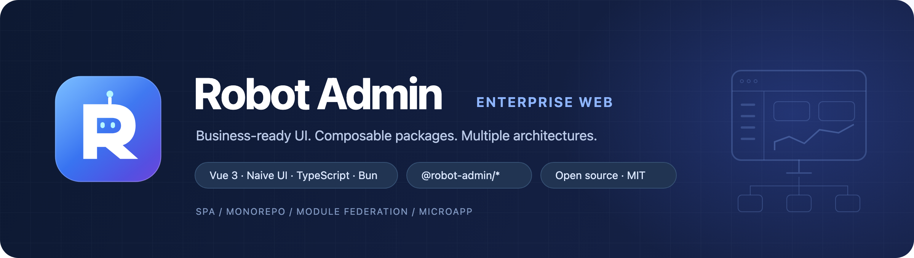
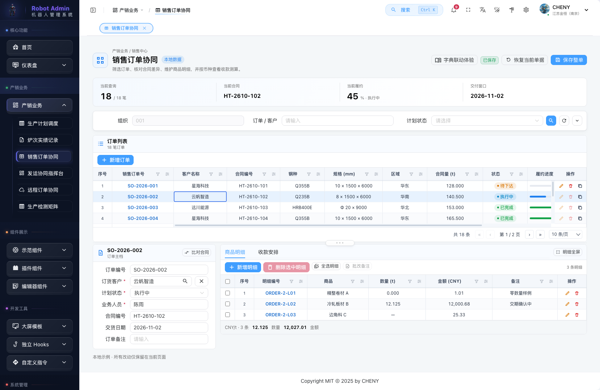
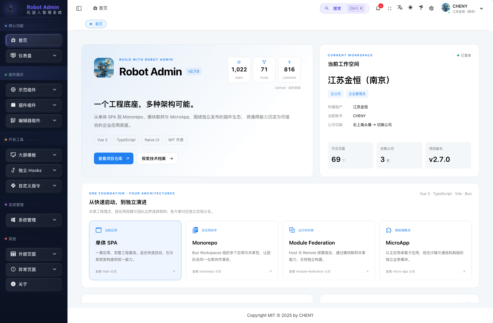
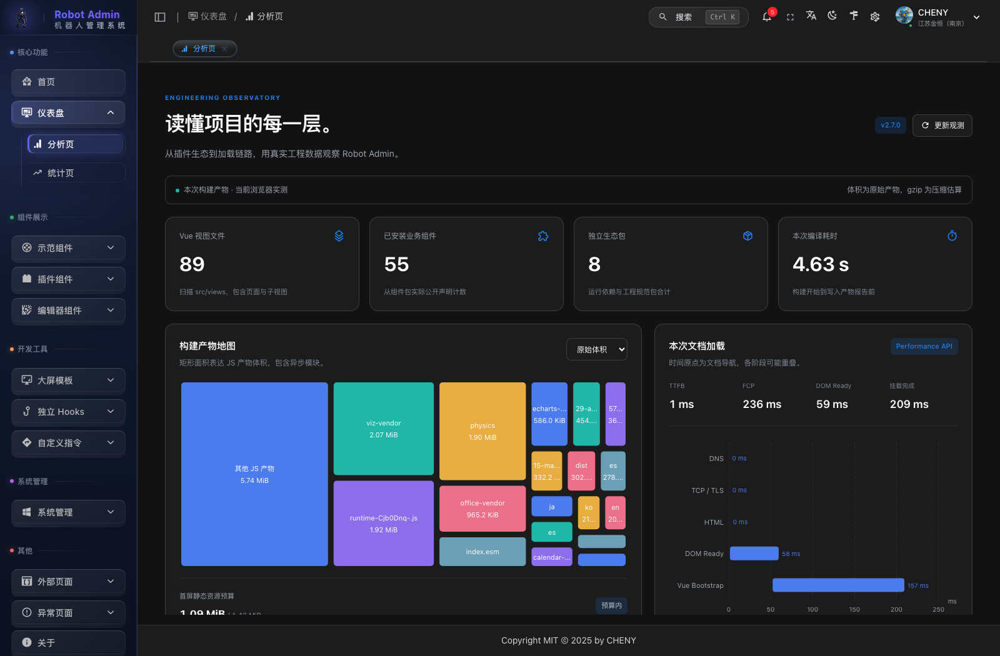
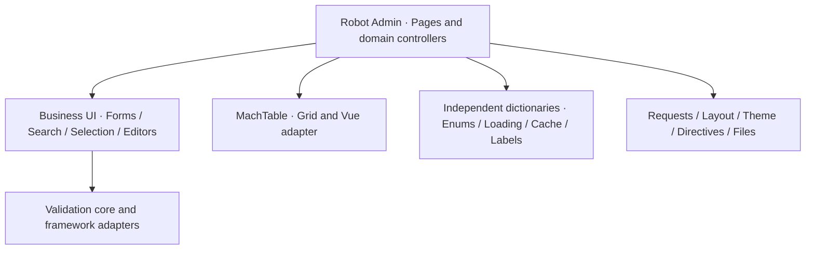

<!-- Banner source and export: docs/assets/robot-admin-banner.svg · bun scripts/render-readme-banner.ts -->



<div align="center">
  <p><strong>One foundation for business, components and multiple architectures.</strong></p>
  <p>Vue 3 · TypeScript · Vite · Naive UI · UnoCSS · Bun</p>
  <p>
    <a href="https://robotadmin.cn">Live demo</a> ·
    <a href="https://www.tzagileteam.com">Component docs</a> ·
    <a href="#quick-start">Quick start</a> ·
    <a href="#scene-experiences">Scenarios</a> ·
    <a href="#architecture-options">Architectures</a> ·
    <a href="#package-ecosystem">Packages</a> ·
    <a href="./README.md">中文</a>
  </p>
  <p>
    <a href="https://github.com/ChenyCHENYU/Robot_Admin/actions/workflows/ci.yml"></a>
    <a href="./package.json"></a>
    <a href="./LICENSE"></a>
    <a href="#capability-map"></a>
    <a href="https://github.com/ChenyCHENYU/Robot_Admin"></a>
  </p>
</div>

## Project scope

**Robot Admin** is a Vue 3 foundation for enterprise PC web applications and a working integration of independent components and plugins. Pages define business models, fields, APIs and permissions; packages implement rendering, validation, loading, cancellation and interaction.

The SPA mainline **v2.7.0** includes company-context authentication, system governance, project analysis, usage statistics and complex production, sales and shipping workspaces. SPA, Monorepo, Module Federation and MicroApp are maintained in separate branches.

| Area               | Available today                                                                                                                  |
| ------------------ | -------------------------------------------------------------------------------------------------------------------------------- |
| Business scenarios | 6 production/sales workspaces with master/detail grids, dense forms, dynamic reports, grouped summaries and a measurement matrix |
| Ecosystem          | 63 business components, 11 directives; 8 runtime `@robot-admin/*` packages and 1 Git tooling package                             |
| Examples           | 58 demo pages covering forms, search, selection, grids, trees, workflows, files and media                                        |
| Engineering        | Types, dual lint, logic/component tests, bundle budgets, browser regression and build identity                                   |

## Quick start

Requires **Node.js ≥22.18.0** and **Bun ≥1.4.2**. [package.json](./package.json) declares dependency ranges; [bun.lock](./bun.lock) pins the actual installation.

```bash
git clone https://github.com/ChenyCHENYU/Robot_Admin.git
cd Robot_Admin
bun install --frozen-lockfile
bun run dev
```

Open **http://localhost:1988/**. A code mirror is available on [Gitee](https://gitee.com/ycyplus163/Robot_Admin).

| Local experience     | Details                                                                                                                                                     |
| -------------------- | ----------------------------------------------------------------------------------------------------------------------------------------------------------- |
| Administrator        | `CHENY / 123456`; complete the verification shown on the login page                                                                                         |
| Company selection    | Verify credentials first; activate an authorized company using the short-lived ticket. Single-company accounts enter directly; switch companies after login |
| Permission scenarios | `STAFF` demonstrates one company; `NOACCESS` demonstrates no authorized company. Mock accepts any nonempty password                                         |
| Network access       | `bun run dev` uses localhost; `bun run dev:ip` displays local and LAN addresses automatically                                                               |

Development enables Mock by default. The public demo uses an explicit `demo` deployment profile. Real applications use `application + remote` and a backend, as described in [Business integration](#business-integration).

## Capability map

### Components and data interaction

| Capability              | Implemented behavior                                                                                                                                                         | Start here                                                                      |
| ----------------------- | ---------------------------------------------------------------------------------------------------------------------------------------------------------------------------- | ------------------------------------------------------------------------------- |
| Forms and dialogs       | Dynamic fields/rules, dependencies, grid/step/dynamic layouts; async validation, submission locks, cancellation and draft protection; compact density with complete feedback | [Form configuration](./docs/form-configuration.md)                              |
| Search                  | Configurable 3/4-column tracks, container adaptation, expand/collapse, history, field settings, fixed conditions and a shared search/reset query callback                    | [Search and selection](./docs/core-components.md#搜索与选择) (Chinese)          |
| Dates and options       | Dates, times, ranges, dependent constraints, remote options and free-text suggestions; multiple tags, long-label overflow and explicit clearing                              | [Demo entries](#component-and-grid-entries)                                     |
| Entity selection        | Paged search, selected-value display and confirm/cancel; select a customer inside the current edit form                                                                      | [Sales implementation](./src/views/production-sales/sales-orders/operations.ts) |
| Business tables         | `C_Table`: configured columns, CRUD editors, tree/expanded rows, native paging, row numbers, status tags, content sizing and row actions                                     | [Choosing a grid](#choosing-a-grid)                                             |
| Dense data grids        | MachTable: virtualization, pinning, editing, merges, selection, paste, row ordering, import validation and complete snapshot output                                          | [MachTable scenarios](./docs/core-components.md#machtable-场景) (Chinese)       |
| Dictionaries and enums  | Remote loading, deduplicated cache, typed values, distinct empty/error states and local retries; shared labels across forms, search, tables and details                      | [Dictionary integration](./docs/dictionaries.md)                                |
| Business composition    | Linked master/detail regions, independent pagination, resizable panes, precise totals, cross-region validation, batch preview and failed-item retries                        | [Production and sales](#production-and-sales)                                   |
| Editing and workflows   | Code, Markdown, rich text, Cron previews, formula evaluation, diagrams and configurable workflow nodes                                                                       | [Workflow example](./src/views/demo/28-work-flow-editor/index.vue)              |
| Files and visualization | Excel/CSV/ZIP, upload/download, previews, printing, signatures, crop, audio/video, calendars, timelines, Gantt and charts                                                    | [Live demo](https://robotadmin.cn)                                              |

### Identity, workspace and observability

| Domain                     | Current implementation                                                                                                                                      |
| -------------------------- | ----------------------------------------------------------------------------------------------------------------------------------------------------------- |
| Company sessions           | Activate an authorized company after verifying credentials; primary/additional memberships, company roles and company switching                             |
| Permissions and governance | Users, roles, menus, dictionaries, dynamic routes, button permissions and temporary role grants; writes follow backend capability and revision checks       |
| Workspace                  | 6 layouts, light/dark/system mode, tabs, page caching, theme settings and feature tours                                                                     |
| Notifications              | Shared inbox, todos, templates, dispatches, audit and preferences; [local demo and remote contract](./docs/enterprise-notifications.md)                     |
| Engineering and usage      | Current repository/build analysis, loading timeline, navigation PV, feature actions and duration percentiles; [metric definitions](./docs/observability.md) |

Company switching clears old permissions, routes, tabs and cached pages. Identity generations reject stale requests. Remote governance writes follow the capability API; a frontend field-permission or data-scope demonstration does not establish backend write support. See [authentication](./docs/enterprise-auth.md) and [production integration](./docs/production-readiness.md).

## Scene experiences

### Production and sales

The production/sales menu corresponds to [src/views/production-sales](./src/views/production-sales/). These six pages work locally without a business backend.

| Page / route                                                                                                               | Interactive behavior                                                                                                                                                                                     |
| -------------------------------------------------------------------------------------------------------------------------- | -------------------------------------------------------------------------------------------------------------------------------------------------------------------------------------------------------- |
| [Production planning](./src/views/production-sales/production-plan/index.vue) · `/#/production-sales/production-plan`      | Production-line tree, plan/heat master-detail grids, advanced queries and capacity; create/edit/confirmed copy/delete, release/revoke and ordering within one line/cast                                  |
| [Production actuals](./src/views/production-sales/production-actual/index.vue) · `/#/production-sales/production-actual`   | Dense numeric entry, composition limits and process trace; draft protection on heat changes, save/review/return, read-only previous-heat reference and adjacent small tables                             |
| [Sales coordination](./src/views/production-sales/sales-orders/index.vue) · `/#/production-sales/sales-orders`             | Resizable vertical workspace, order header and product/payment details, contract comparison and inline customer selection; precise totals, whole-order validation, batch changes and failed-item retries |
| [Shipping coordination](./src/views/production-sales/shipping/index.vue) · `/#/production-sales/shipping`                  | C_Table task queue, MachTable stock matching, vehicle form and grouped reports; weight conservation, overload checks, loading locks and confirmed departure                                              |
| [Remote order workbench](./src/views/production-sales/remote-workbench/index.vue) · `/#/production-sales/remote-workbench` | Async master/detail regions with independent paging/loading/retry; delivery/quality schemas return columns and rows together; slow/error/empty-detail and late-dictionary scenarios                      |
| [Measurement matrix](./src/views/production-sales/production-matrix/index.vue) · `/#/production-sales/production-matrix`   | Date/shift groups, fixed metrics, compound value/time editors, batch paste and undo; hidden-date edits retained, full snapshot preview/CSV/XLSX/print                                                    |

Business lists show row numbers, pinned edit/delete actions and blue identifiers opening read-only detail dialogs. Row clicks update the workspace. Copy creates independent records only after confirmation; cancellation consumes no ID. Switching records and cross-row edits retain save/discard/cancel protection. Business actions use semantic icons.

Desktop panes resize, narrow layouts stack, and short viewports scroll. Grids retain internal scrolling, reachable paging and horizontal rails. Short order, heat and stock details shrink to content; larger bodies scroll within their limit.

These pages use explicitly labeled local sources. “Remote order workbench” demonstrates an asynchronous API contract, not a connected production order service. Real integration supplies column descriptions, stable row keys, accurate `total` and cancellation signals at the API boundary. The old `/#/demo/business-workbench` redirects to sales; public previews use `/#/preview/production-sales/<page-path>`.

### Component and grid entries

| Scenario               | Route                                                          | What to inspect                                                                                                       |
| ---------------------- | -------------------------------------------------------------- | --------------------------------------------------------------------------------------------------------------------- |
| Forms / search         | `/#/demo/form-manage/form` · `/#/demo/form-manage/form-search` | Layouts, density, dynamic rules, folding, history, multiple selections and boolean values                             |
| Dates / times          | `/#/demo/date` · `/#/demo/time`                                | Single/range/formatted values, constraints and standalone/composed use                                                |
| Trees / panes          | `/#/demo/tree` · `/#/demo/split-pane`                          | Controlled selection, virtual tree, retryable local lazy loading, nested grids and independent scroll                 |
| Super Table            | `/#/demo/table-manage/table`                                   | Modal/row/cell/mixed editing, density, paging, row numbers and enum labels                                            |
| MachTable              | `/#/demo/table-manage/mach-table`                              | CRUD, cell/row editing, data workbench, tree rows, ordering, import validation and a logical ten-million-row viewport |
| Dictionary composition | Sales coordination → “字典联动体验”                            | Shared requests, empty dictionaries, retries, scope switching, `0/false/"0"/"001"` and multiple values                |
| Workflow               | `/#/editor/work-flow-editor`                                   | Nodes, approval modes, conditions, read-only preview, local drafts and export                                         |

The demo directory contains **58 demo pages + 8 form layouts + 3 embedded components (69 index.vue files)**, counted separately from the six production/sales pages. See the [current integration guide](./docs/core-components.md) (Chinese) for further entries and composition examples.

MachTable ordering supports multi-item drag, keyboard movement, undo/redo and simulated save failure/version conflicts. Import validation previews normalized values and row problems before committing. The large-data viewport generates logical data in blocks of 200 rows and caches at most 8 blocks; it does not allocate a ten-million-row array.

### Page previews

[](docs/assets/production-sales-workspace.png)

<details>
<summary>Home and dark engineering analysis</summary>

|                                         Workspace · light                                          |                                       Engineering analysis · dark                                        |
| :------------------------------------------------------------------------------------------------: | :------------------------------------------------------------------------------------------------------: |
| [](docs/assets/workspace-light.png) | [](docs/assets/analysis-dark.png) |

</details>

Screenshots use the current mainline's local Mock data. The online site's functionality follows its deployed version.

## Choosing a grid

| Use case                                    | Entry                                    | Page-owned inputs                                                                   |
| ------------------------------------------- | ---------------------------------------- | ----------------------------------------------------------------------------------- |
| Business lists, CRUD, tree/expanded rows    | `C_Table`                                | `columns` + `data`, with optional `config` or `crud`                                |
| Large data, wide tables and dense editors   | MachTable; omitted `preset` means `list` | `column-defs` + `row-data` or a public data source                                  |
| Details and multiple small read-only tables | MachTable `preset="detail"`              | Columns and rows; plain headers and bounded auto-height without repeated tool flags |

```vue
<C_Table :columns="columns" :data="rows" />
<MachTable :column-defs="columnDefs" :row-data="rows" />
<MachTable
  preset="detail"
  :column-defs="detailColumns"
  :row-data="detailRows"
/>
```

These fragments use the project's installed auto-imports and asynchronous grid plugin. Each grid keeps its own column protocol and pager. Row numbers and centered text/numbers are defaults; `pagination` and `row-number` can be disabled explicitly. The `detail` preset already provides its own defaults.

- **Sizing:** automatic business columns measure complete headers and bounded display values, then share spare width proportionally. Utility columns stay compact. A resize changes only its target and protects header text/controls; body overflow remains independently readable. Saving a width preserves the original presentation policy.
- **Height and appearance:** full lists scroll within the workspace; short details shrink to content and larger bodies scroll within their limit. Each grid retains its own themes and empty state. Status tags, ordinary enums and important numeric values have separate configurable presentation.
- **Dynamic data:** the API boundary maps each grid's public column definition. The remote example commits columns and rows as one result and rejects stale responses; dictionary changes refresh display without refetching business data.
- **Personal preferences:** grids with `persistKey/persistence` enabled are scoped by tenant, company, user and table. Incomplete identity disables storage. C_Table receives one application scope getter; MachTable captures its key during setup, with identity changes rebuilding the layout owner. B starts with defaults if it has no settings; A's queued writes and restored preferences remain A's. Current examples are the shipping queue and MachTable demo.

Shared appearance lives in [MachTable config](./src/config/mach-table.ts) and the [component plugin](./src/plugins/naive-ui-plugin.ts). See [composition examples](./docs/core-components.md) (Chinese) for forms, search, dictionaries and tables.

## Architecture options

Choose by **collaboration model and deployment boundaries**. Each architecture lives in a separate branch with its own configuration, entry points and verification commands.

| Architecture          | Current structure                                                                              | Best suited to                                                         | Code and integration                                                                                                                                                                   |
| --------------------- | ---------------------------------------------------------------------------------------------- | ---------------------------------------------------------------------- | -------------------------------------------------------------------------------------------------------------------------------------------------------------------------------------- |
| **SPA**               | Current mainline: one application, dynamic permission routes and independent npm packages      | A single admin system, a team template or an initial business delivery | [`main`](https://github.com/ChenyCHENYU/Robot_Admin/tree/main) · this document                                                                                                         |
| **Monorepo**          | Bun Workspaces, `admin-internal` / `admin-saas` applications and shared configuration packages | Multiple products maintained together and built or deployed separately | [`monorepo`](https://github.com/ChenyCHENYU/Robot_Admin/tree/monorepo) · [upgrade guide](https://github.com/ChenyCHENYU/Robot_Admin/blob/monorepo/docs/MONOREPO_UPGRADE.md)            |
| **Module Federation** | Separate `remoteEntry.js` artifact, Vue bridge, logistics consumer and integration checks      | Runtime consumption of remote modules and separate releases            | [`module-federation`](https://github.com/ChenyCHENYU/Robot_Admin/tree/module-federation) · [branch guide](https://github.com/ChenyCHENYU/Robot_Admin/blob/module-federation/README.md) |
| **MicroApp**          | Portal, independent applications, iframe sandbox, theme and context communication              | Existing systems behind a portal and independently maintained teams    | [`micro-app`](https://github.com/ChenyCHENYU/Robot_Admin/tree/micro-app) · [upgrade guide](https://github.com/ChenyCHENYU/Robot_Admin/blob/micro-app/docs/MICRO_APP_UPGRADE.md)        |

Versions and capabilities follow each branch's manifests. Switching architecture requires its integration and acceptance process. The Monorepo SaaS application is currently an architecture demonstration shell. The `systemApp / public / template` platform split is a [future plan](./docs/module-federation-platform-plan.md), distinct from the existing Module Federation branch.

## Package ecosystem

Independent packages expose public APIs; the application composes them through configuration and domain controllers. Dictionaries provide ordinary options and formatters to the application. Forms and grids do not recognize dictionary instances or business dictionary codes.



These are **the versions pinned by this application**. Full APIs and upstream capabilities follow each package's documentation.

| Package                                                                                              | Pinned version | Core capabilities                                                                       | Application responsibility                                        |
| ---------------------------------------------------------------------------------------------------- | -------------- | --------------------------------------------------------------------------------------- | ----------------------------------------------------------------- |
| [`@robot-admin/naive-ui-components`](https://www.npmjs.com/package/@robot-admin/naive-ui-components) | `0.38.0`       | 63 business components, subpath imports, auto-import Resolver and independent styles    | Forms, tables, menus, editors and shared feedback                 |
| [`@robot-admin/dictionary`](https://www.npmjs.com/package/@robot-admin/dictionary)                   | `0.6.1`        | Static enums, resilient remote dictionaries, scoped cache and detail field bindings     | Shared translation for forms, search, details and both grids      |
| [`@robot-admin/request-core`](https://www.npmjs.com/package/@robot-admin/request-core)               | `0.7.0`        | Instance-based request orchestration, auth recovery, cancellation and Headless CRUD     | Typed APIs, session consistency, list and editor state            |
| [`@robot-admin/form-validate`](https://www.npmjs.com/package/@robot-admin/form-validate)             | `3.4.4`        | Core rules, composition, batch validation, Naive UI / Element Plus adapters             | Integrated into `C_Form`; configure rules directly                |
| [`@robot-admin/layout`](https://www.npmjs.com/package/@robot-admin/layout)                           | `3.2.3`        | 6 layouts, framework-independent settings protocol, Vue Headless and Naive entry points | Host-owned menus, routes and slots; package-owned layout behavior |
| [`@robot-admin/theme`](https://www.npmjs.com/package/@robot-admin/theme)                             | `0.6.1`        | Theme core, Vue state, Naive UI adapter, light / dark / system                          | Shared component appearance and theme state                       |
| [`@robot-admin/directives`](https://www.npmjs.com/package/@robot-admin/directives)                   | `2.0.1`        | 11 directives for permissions, copy, drag, debounce, throttle and more                  | Declarative interactions with unmount cleanup                     |
| [`@robot-admin/file-utils`](https://www.npmjs.com/package/@robot-admin/file-utils)                   | `3.0.4`        | Isolated instances, Excel / CSV / ZIP, cancellable chunks and file processing           | Reusable file scenarios with heavy dependencies loaded on demand  |
| [`@robot-admin/git-standards`](https://www.npmjs.com/package/@robot-admin/git-standards)             | `1.0.5`        | Configuration protection and Git engineering standards                                  | Development-time commit conventions and initialization            |

The grid integration uses **MachTable 0.41.1** · [`@agile-team/mach-table-vue`](https://www.npmjs.com/package/@agile-team/mach-table-vue). Robot Admin currently integrates Vue. See [MachTable](https://github.com/ChenyCHENYU/MachTable) for Core, React, XLSX and other optional capabilities; [naive-ui-components](https://github.com/ChenyCHENYU/naive-ui-components) and [robot-admin-packages](https://github.com/ChenyCHENYU/robot-admin-packages) host the component and runtime sources.

## Engineering and verification

| Mechanism                         | Check and scope                                                                                                                          |
| --------------------------------- | ---------------------------------------------------------------------------------------------------------------------------------------- |
| Environment/deployment validation | Validate environment, proxy and deployment purpose; application builds reject Mock and source-package aliases                            |
| Loading and caches                | Route splitting, component subpaths, network/device-aware prefetch and development restarts on dependency changes                        |
| Bundle budgets                    | Entry, preload, CSS, initial total, request count and largest async chunk; `bun run check:bundle`                                        |
| Types and behavior                | Dual lint, style boundaries, type checks, Bun logic tests and mounted Vue components                                                     |
| Browser regression                | Published-package builds, grid interaction, light/dark, narrow/short screens, tag navigation, account/company switching and actual paint |
| Build identity                    | `/build-info.json` records version, environment, deployment profile, commit and build time; [traceability](./docs/build-identity.md)     |

```bash
bun run verify                   # Lint, styles, types, logic/components, both build modes, budgets
bunx playwright install chromium  # First browser installation
bun run test:e2e                  # Page regression against built artifacts
```

The [CI configuration](./.github/workflows/ci.yml) includes verification, dependency audit, browser and high-DPI paint checks. Counts and measurements correspond to a specific commit and environment, rather than permanent performance promises. See [observability](./docs/observability.md).

[AGENTS.md](./AGENTS.md) and the [coding guide](./.github/copilot-instructions.md) define naming, layout, imports, styles and commits. Seven project Skills cover development workflows. Run `bun run mcp` to query component APIs, routes, endpoints and validation presets through the [MCP server](./mcp/server.ts).

## Business integration

### 1. Select deployment and data modes

Configure the untracked `envs/.env.local` or the deployment environment:

```dotenv
VITE_DEPLOYMENT_PROFILE=application
VITE_AUTH_MODE=remote
VITE_DATA_MODE=remote
VITE_API_BASE=/api
# Local proxy only; use a same-origin /api gateway after deployment.
API_PROXY_TARGET=https://your-api.example.com
```

`bun run build` generates the public demo in `dist/`; `bun run build:application` creates application staging acceptance artifacts in `dist/application/`. Remote failures do not fall back to demo data. Configure real APIs and the gateway using the [production baseline](./docs/production-readiness.md).

### 2. Align session, resource and write contracts

| Area                    | Current Remote contract                                                                                                                                                               |
| ----------------------- | ------------------------------------------------------------------------------------------------------------------------------------------------------------------------------------- |
| Multi-company login     | Credentials first; single-company accounts establish a session directly, while multi-company activation uses a short-lived, one-time ticket held only in page memory                  |
| Menus and authorization | Stable `robot-menu:${menuId}` route identity; accounts without home enter their first permitted page, and empty menus show no access. The backend enforces button and data scope      |
| Concurrent writes       | Preserve read-model `revision`; submit `revision/expectedRevision` per resource. Re-read conflicts without silently replacing the expected revision                                   |
| Temporary roles         | Create/revoke by role, window and reason; UTC transport and local display, with revision-aware revocation                                                                             |
| Governance boundary     | Capability-driven writes; data-scope summaries, constraints and audit are currently read-only. Field permissions are not integrated; capability errors keep writes disabled           |
| Personal account        | Remote saves nickname/email/mobile, with explicit `null` clearing contacts. Avatar/bio and security toggles follow current read-only boundaries; password changes use a dedicated API |

See [authentication](./docs/enterprise-auth.md) for membership/company activation and `src/api/*contract.ts` for resource fields. When integrating [Robot Cloud](https://github.com/ChenyCHENYU/Robot_Cloud), retain both build identities and gateway responses, and verify conflicts, revoked access, disabled membership and temporary-grant boundaries.

### 3. Add telemetry and deployment

Usage statistics default to local browser samples. Site-wide aggregation requires same-origin collection/query APIs. Vercel Analytics / Speed Insights load only in production when explicitly enabled. [vercel.json](./vercel.json) supplies route fallback and security headers; other platforms follow the [production guide](./docs/production-readiness.md).

## Internationalization and design

CSS variables and Naive UI providers share light/dark/system state across six layouts. Languages are `zh-cn / en / ja / ko`; Chinese is the source and only the selected external dictionary loads. Ordinary development and production builds do not call translation services.

Generate new terms explicitly with `bun run i18n:generate`, review the language files and commit them. Language switching retains one refresh to synchronize static labels, menus and tabs. See [i18n maintenance](./docs/internationalization.md) and the [design system](./docs/design-system/README.md).

## Technology and structure

Exact versions reflect the current lockfile. Declared ranges and the full dependency list remain in `package.json`.

| Layer        | Current technology                                                                      |
| ------------ | --------------------------------------------------------------------------------------- |
| Application  | **Vue 3.5.42** · **TypeScript 5.8.3** · **Pinia 4.0.3** · **Vue Router 5.3.1**          |
| UI           | **Naive UI 2.45.3** · **UnoCSS 66.9.1** · **VueUse 14.4.0**                             |
| Build        | **Vite 8.2.4** · Bun · Sass · Auto-import and component Resolver                        |
| Data grid    | **MachTable 0.41.1** · Vue adapter                                                      |
| Verification | Oxlint / ESLint · vue-tsc · Bun Test · Vitest / Vue Test Utils / happy-dom · Playwright |

```text
Robot_Admin/
├── src/
│   ├── api/                 # Resource contracts, Mock adapters and remote APIs
│   ├── components/          # Global host components and local business components
│   ├── composables/         # Application logic for login, layouts and caching
│   ├── config/              # Vite, themes, tours and observability
│   ├── constant/            # Shared application constants
│   ├── plugins/             # Request, layout, theme and telemetry initialization
│   ├── router/              # Permission routes and standalone previews
│   ├── stores/              # User, permission, language and settings state
│   ├── styles/              # Global entry and theme variables
│   ├── types/               # Application and domain types
│   ├── utils/               # Sessions, routes, i18n and error handling
│   └── views/               # Home, analytics, system management and examples
├── envs/                    # Environment and deployment profiles
├── lang/                    # Flat per-language dictionaries
├── patches/                 # Pinned i18n plugin adapters
├── scripts/                 # Builds, styles, budgets and branch synchronization
├── tests/                   # Logic, contracts and mounted component tests
├── e2e/                     # Browser regression against production artifacts
├── mcp/                     # Project fact tools
└── docs/                    # Integration, design and maintenance
```

### Common commands

| Goal                                  | Command                                                           |
| ------------------------------------- | ----------------------------------------------------------------- |
| Standard development / LAN access     | `bun run dev` / `bun run dev:ip`                                  |
| Quiet startup / Vue DevTools          | `bun run dev:quiet` / `bun run dev:devtools`                      |
| Published-package type checks         | `bun run type-build`                                              |
| Read-only code checks                 | `bun run lint:check` + `bun run lint:eslint`                      |
| Production demo / application staging | `bun run build` / `bun run build:application`                     |
| Artifact preview / bundle analysis    | `bun run preview` / `bun run analyze`                             |
| Conventional commit                   | `bun run commit`                                                  |
| Feature branch to dev / main          | `bun run deploy`; verify, merge and push; no version bump or tags |

Source-package development, isolated caches, port troubleshooting and further commands are covered in the [development guide](./docs/development.md). Release Please manages application versions and formal changelogs; history lives in [CHANGELOG.md](./CHANGELOG.md).

## Robot ecosystem

One brand spans several delivery platforms, with each project retaining the components, toolchain and integration contracts appropriate to its platform.

| Project                                                           | Scope                                                                 | Relationship to Robot Admin                            |
| ----------------------------------------------------------------- | --------------------------------------------------------------------- | ------------------------------------------------------ |
| **Robot Admin**                                                   | PC enterprise admin, architecture options and package ecosystem       | Web application practice for reusable npm packages     |
| [**Robot H5**](https://github.com/ChenyCHENYU/Robot_H5)           | Vue enterprise mobile applications in browsers and App / PDA WebViews | Mobile business workflows and host device capabilities |
| [**Robot UniApp**](https://github.com/ChenyCHENYU/Robot_uniApp)   | uni-app for H5, WeChat mini programs and App                          | Cross-platform pages and native integrations           |
| [**Robot H5 Core**](https://github.com/ChenyCHENYU/Robot_H5_Core) | Mobile device capabilities and platform adapters                      | Browser and host boundaries used by Robot H5           |
| [**Robot CLI**](https://github.com/ChenyCHENYU/robot-cli)         | Project scaffolding                                                   | Template creation and initialization                   |
| [**AgileTeam Doc**](https://www.tzagileteam.com)                  | Team engineering and component documentation                          | Component APIs, practices and standalone previews      |

The cover uses Robot H5's blue-violet R / robot mark, navy grid and typography. Its SVG source and high-resolution PNG are stored locally for GitHub, Gitee and offline reading.

## Documentation and contribution

| Topic                                  | Entry                                                                                                                                      |
| -------------------------------------- | ------------------------------------------------------------------------------------------------------------------------------------------ |
| Current capabilities and composition   | [Components, search, grids and business scenarios](./docs/core-components.md) (Chinese)                                                    |
| Dictionaries, enums and detail labels  | [Dictionary integration](./docs/dictionaries.md)                                                                                           |
| Forms, validation and async submission | [Form configuration](./docs/form-configuration.md)                                                                                         |
| Development and maintenance            | [Development](./docs/development.md) · [Documentation index](./docs/README.md)                                                             |
| Production integration                 | [Baseline](./docs/production-readiness.md) · [Authentication](./docs/enterprise-auth.md) · [Environment](./envs/README.md)                 |
| Metrics, builds and regression         | [Observability](./docs/observability.md) · [Build identity](./docs/build-identity.md) · [Runtime regression](./docs/runtime-regression.md) |
| Design and collaboration               | [Design system](./docs/design-system/README.md) · [Contributing](./CONTRIBUTING.md) · [Agent guide](./AGENTS.md)                           |
| History                                | [CHANGELOG](./CHANGELOG.md) · [Releases](https://github.com/ChenyCHENYU/Robot_Admin/releases)                                              |

Include the route, reproduction steps, browser version and build identity when reporting [GitHub Issues](https://github.com/ChenyCHENYU/Robot_Admin/issues). Author: [CHENY](https://github.com/ChenyCHENYU) · [ycyplus@gmail.com](mailto:ycyplus@gmail.com).

**MIT License**. Commercial use and modification are permitted while retaining license and copyright notices. Dependencies follow their own licenses. Thanks to Vue, Vite, Naive UI, UnoCSS, Bun and ecosystem maintainers.
