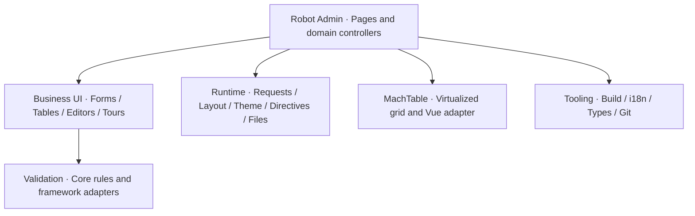

<!-- Banner source and export: docs/assets/robot-admin-banner.svg · bun scripts/render-readme-banner.ts -->


<div align="center">
  <p><strong>One foundation for business, components and multiple architectures.</strong></p>
  <p>Vue 3 · TypeScript · Vite · Naive UI · UnoCSS · Bun</p>
  <p>
    <a href="https://robotadmin.cn">Live demo</a> ·
    <a href="https://www.tzagileteam.com">Component docs</a> ·
    <a href="#quick-start">Quick start</a> ·
    <a href="#architecture-options">Architectures</a> ·
    <a href="#package-ecosystem">Packages</a> ·
    <a href="./README.md">中文</a>
  </p>
  <p>
    <a href="https://github.com/ChenyCHENYU/Robot_Admin/actions/workflows/ci.yml"></a>
    <a href="./package.json"></a>
    <a href="./LICENSE"></a>
    <a href="#capability-map"></a>
    <a href="https://github.com/ChenyCHENYU/Robot_Admin"></a>
  </p>
</div>

## Project scope

**Robot Admin** is a Vue 3 enterprise admin template and the PC Web entry in the Robot ecosystem. Identity, permissions, layouts, forms, tables, editors and engineering checks are organized as composable capabilities. The application owns business configuration; independently published packages own reusable implementations.

The current SPA mainline, **v2.7.0**, includes company-context login, system management, project analysis and usage statistics. Monorepo, Module Federation and MicroApp have separate architecture branches. Start with a single admin application or choose a structure that matches your collaboration and deployment needs.

| Perspective                   | Included today                                                                                           |
| ----------------------------- | -------------------------------------------------------------------------------------------------------- |
| Architectures                 | SPA, Bun Workspaces, Module Federation and MicroApp branches                                             |
| Components and packages       | 60 business components, 11 directives; 7 runtime `@robot-admin/*` packages and 1 Git tooling package     |
| Examples                      | 58 demo pages covering data entry, complex grids, workflow editing, files and media                      |
| Verification and traceability | Dual lint, types, logic and component tests, bundle budgets, browser paint regression and build identity |

## Quick start

Requires **Node.js ≥22.18.0** and **Bun ≥1.4.2**. [package.json](./package.json) declares dependency ranges; [bun.lock](./bun.lock) pins the actual installation.

```bash
git clone https://github.com/ChenyCHENYU/Robot_Admin.git
cd Robot_Admin
bun install --frozen-lockfile
bun run dev
```

Open **http://localhost:1988/**. A code mirror is available on [Gitee](https://gitee.com/ycyplus163/Robot_Admin).

| Local experience     | Details                                                                                                                    |
| -------------------- | -------------------------------------------------------------------------------------------------------------------------- |
| Administrator        | `CHENY / 123456`; complete the verification shown on the login page                                                        |
| Company selection    | Look up company memberships after entering the account, select one before login, and switch context inside the application |
| Permission scenarios | `STAFF` demonstrates one company; `NOACCESS` demonstrates no authorized company. Mock accepts any nonempty password        |
| Network access       | `bun run dev` uses localhost; `bun run dev:ip` displays local and LAN addresses automatically                              |

Development enables Mock by default. The public demo uses an explicit `demo` deployment profile. Real applications use `application + remote` and a backend, as described in [Business integration](#business-integration).

## Capability map

### Identity and workspace

| Domain                     | Current implementation                                                                                          | Practical value                                                                     |
| -------------------------- | --------------------------------------------------------------------------------------------------------------- | ----------------------------------------------------------------------------------- |
| Company and identity       | Company selection before login, primary and additional memberships, company roles, context switching            | Login and the workspace use the same company context                                |
| Permissions and governance | Users, roles, permissions, menus, dictionaries, dynamic routes, button permissions and data-scope configuration | A complete frontend flow from account authorization to navigation and actions       |
| Workspace                  | 6 layouts, theme settings, tabs, menu-configured page caching and feature tours                                 | Consistent navigation and feedback at different information densities               |
| Project analysis           | Source and dependency distribution, build artifacts, browser loading timeline and real repository counts        | Charts grounded in the current project and its engineering state                    |
| Usage statistics           | Successful-navigation PV, login and company-switch events, feature actions and route-duration percentiles       | Local browser samples by default; API integration for site-wide summaries           |
| Enterprise notifications   | Shared inbox, independent todos, templates, dispatches, delivery records, audit and preferences                 | [Backend-free demo and remote adapter contract](./docs/enterprise-notifications.md) |
| Data workbenches           | Shared form/search/table density, controlled virtual trees and nested three-table layouts                       | [0.17 integration and demos (Chinese)](./docs/core-components-0.17.md)              |

Company switches update the session and clear old permissions, dynamic routes and tabs. Route registration and request responses use identity generations to reject stale results. See the [enterprise authentication contract](./docs/enterprise-auth.md) for backend context activation and isolation, and [observability](./docs/observability.md) for metric definitions.

### Business components and specialist workspaces

| Component domain       | Representative capabilities                                                                                                                            |
| ---------------------- | ------------------------------------------------------------------------------------------------------------------------------------------------------ |
| Forms                  | Configured fields, dynamic and cross-field rules, async submission, step and grid layouts                                                              |
| Tables                 | `C_Table` provides consistent loading, alignment and pagination; MachTable adds virtualization, editing, selection, column state and responsive widths |
| Editors and workflows  | Cron expressions and execution previews, formula keyboard and evaluation, code / Markdown / rich text, workflows and diagrams                          |
| Files and media        | Excel, CSV, ZIP, upload and download, signature and crop, audio and video, preview and print scenarios                                                 |
| Time and visualization | Date, city, calendars, timelines, Gantt, charts and large-screen templates                                                                             |
| Application experience | Menus, search, theme, language, tours, empty states, error pages and route-loading feedback                                                            |

The demo directory contains **58 demo pages + 8 form layouts + 3 embedded components (69 index.vue files)**. Independent component and style entry points keep heavy editors, charts, workflows and media loaded by route. Explore the [component library](https://github.com/ChenyCHENYU/naive-ui-components) or the [live demo](https://robotadmin.cn).

> Cron previews do not schedule backend jobs; formula evaluation does not modify business data. Demo data, frontend data-scope configuration and button controls require real APIs and server authorization for production use.

### Page previews

|                                         Workspace · light                                          |                                       Engineering analysis · dark                                        |
| :------------------------------------------------------------------------------------------------: | :------------------------------------------------------------------------------------------------------: |
| [](docs/assets/workspace-light.png) | [](docs/assets/analysis-dark.png) |

Captured from the current SPA mainline running locally. Engineering metrics come from the current build and browser; company and account contexts are Mock fixtures.

## Architecture options

Choose by **collaboration model and deployment boundaries**. Each architecture lives in a separate branch with its own configuration, entry points and verification commands.

| Architecture          | Current structure                                                                              | Best suited to                                                         | Code and integration                                                                                                                                                                   |
| --------------------- | ---------------------------------------------------------------------------------------------- | ---------------------------------------------------------------------- | -------------------------------------------------------------------------------------------------------------------------------------------------------------------------------------- |
| **SPA**               | Current mainline: one application, dynamic permission routes and independent npm packages      | A single admin system, a team template or an initial business delivery | [`main`](https://github.com/ChenyCHENYU/Robot_Admin/tree/main) · this document                                                                                                         |
| **Monorepo**          | Bun Workspaces, `admin-internal` / `admin-saas` applications and shared configuration packages | Multiple products maintained together and built or deployed separately | [`monorepo`](https://github.com/ChenyCHENYU/Robot_Admin/tree/monorepo) · [upgrade guide](https://github.com/ChenyCHENYU/Robot_Admin/blob/monorepo/docs/MONOREPO_UPGRADE.md)            |
| **Module Federation** | Separate `remoteEntry.js` artifact, Vue bridge, logistics consumer and integration checks      | Runtime consumption of remote modules and separate releases            | [`module-federation`](https://github.com/ChenyCHENYU/Robot_Admin/tree/module-federation) · [branch guide](https://github.com/ChenyCHENYU/Robot_Admin/blob/module-federation/README.md) |
| **MicroApp**          | Portal, independent applications, iframe sandbox, theme and context communication              | Existing systems behind a portal and independently maintained teams    | [`micro-app`](https://github.com/ChenyCHENYU/Robot_Admin/tree/micro-app) · [upgrade guide](https://github.com/ChenyCHENYU/Robot_Admin/blob/micro-app/docs/MICRO_APP_UPGRADE.md)        |

Versions and capabilities follow each branch's manifests. Switching architecture requires its integration and acceptance process. The Monorepo SaaS application is currently an architecture demonstration shell. The `systemApp / public / template` platform split is a [future plan](./docs/module-federation-platform-plan.md), distinct from the existing Module Federation branch.

## Package ecosystem

### Independently published, composed by responsibility

Business components, framework adapters and core engines are maintained separately. Robot Admin consumes public APIs and composes them through page configuration. The packages can also be integrated into other applications according to their own documentation.



Versions below are **the versions pinned by this application**. Upgrades follow package release notes, public contracts and application verification.

| Package                                                                                              | Pinned version | Core capabilities                                                                       | Application responsibility                                        |
| ---------------------------------------------------------------------------------------------------- | -------------- | --------------------------------------------------------------------------------------- | ----------------------------------------------------------------- |
| [`@robot-admin/naive-ui-components`](https://www.npmjs.com/package/@robot-admin/naive-ui-components) | `0.24.1`       | 60 business components, subpath imports, auto-import Resolver and independent styles    | Forms, tables, menus, editors and shared feedback                 |
| [`@robot-admin/request-core`](https://www.npmjs.com/package/@robot-admin/request-core)               | `0.7.0`        | Instance-based request orchestration, auth recovery, cancellation and Headless CRUD     | Typed APIs, session consistency, list and editor state            |
| [`@robot-admin/form-validate`](https://www.npmjs.com/package/@robot-admin/form-validate)             | `3.4.4`        | Core rules, composition, batch validation, Naive UI / Element Plus adapters             | Integrated into `C_Form`; configure rules directly                |
| [`@robot-admin/layout`](https://www.npmjs.com/package/@robot-admin/layout)                           | `3.2.3`        | 6 layouts, framework-independent settings protocol, Vue Headless and Naive entry points | Host-owned menus, routes and slots; package-owned layout behavior |
| [`@robot-admin/theme`](https://www.npmjs.com/package/@robot-admin/theme)                             | `0.6.1`        | Theme core, Vue state, Naive UI adapter, light / dark / system                          | Shared component appearance and theme state                       |
| [`@robot-admin/directives`](https://www.npmjs.com/package/@robot-admin/directives)                   | `2.0.1`        | 11 directives for permissions, copy, drag, debounce, throttle and more                  | Declarative interactions with unmount cleanup                     |
| [`@robot-admin/file-utils`](https://www.npmjs.com/package/@robot-admin/file-utils)                   | `3.0.4`        | Isolated instances, Excel / CSV / ZIP, cancellable chunks and file processing           | Reusable file scenarios with heavy dependencies loaded on demand  |
| [`@robot-admin/git-standards`](https://www.npmjs.com/package/@robot-admin/git-standards)             | `1.0.5`        | Configuration protection and Git engineering standards                                  | Development-time commit conventions and initialization            |

Sources: [naive-ui-components](https://github.com/ChenyCHENYU/naive-ui-components) and [robot-admin-packages](https://github.com/ChenyCHENYU/robot-admin-packages).

The application provides `compact` defaults for forms, search and editor modals. Empty validation feedback reserves 4px while real errors expand naturally; compact search fields default to 208px. Numeric fields retain Naive UI precision, limits and keyboard stepping, with step buttons hidden by default and available through `attrs.showButton`. Modal footer and confirmation buttons use a consistent 22px height. Local density, field sizes and explicit layout gaps remain configurable. See [form configuration](./docs/form-configuration.md).

### Data grid and engineering plugins

| Capability           | Integration                                                                                    | Actual purpose                                                                                                   |
| -------------------- | ---------------------------------------------------------------------------------------------- | ---------------------------------------------------------------------------------------------------------------- |
| **MachTable 0.35.2** | [`@agile-team/mach-table-vue`](https://www.npmjs.com/package/@agile-team/mach-table-vue)       | Core + Vue adapter; virtualization, pinned columns, editing, row reordering and configurable row colors          |
| Startup information  | [`vite-console-plugin`](https://www.npmjs.com/package/vite-console-plugin)                     | Development banner with application version, Git information and access URLs                                     |
| Internationalization | `vite-auto-i18n-plugin` + repository `patches/`                                                | Chinese source scanning, offline compilation, language-specific dictionaries and explicit translation generation |
| Type maintenance     | [`ts-type-cleaner`](https://www.npmjs.com/package/ts-type-cleaner)                             | Type-usage analysis through `bun run check-types`                                                                |
| Branch comparison    | [`git-branch-check-diff-commits`](https://www.npmjs.com/package/git-branch-check-diff-commits) | Commit comparison through `bun run check-branch`                                                                 |

MachTable is a separate data grid project. Core and Vue / React / XLSX adapters are documented in [MachTable](https://github.com/ChenyCHENYU/MachTable). Robot Admin currently integrates the Vue adapter; ordinary business tables and dense data grids serve different scenarios.

Open **Table Management → MachTable → 顺序调整** (`/#/demo/table-manage/mach-table`) to reorder 30 demo orders. The demo imports optional `/ordering` on demand: select nonadjacent items and drag one selected handle to move them in their original relative order. Edge scrolling, Escape, Alt + Up / Down and separate ordering undo/redo are supported. Keyboard moves target adjacent visible orders in search results, while hidden orders remain in the full dataset. The existing toolbar offers a 450ms simulated save, failure rollback and version conflict; reload the simulated server order after a conflict. Status text shows the save result and both revisions. Switching scenarios preserves confirmed order and cancels an unfinished save. All transport is local simulation and never writes to the order API.

The dependency and lockfile pin official npm **0.35.2**, with matching Vue and Core versions. This release adds bounded content sizing for undeclared widths, complete headers in initial layout, fit, restored widths and interactive resizing, and concise `status` column configuration. Production plans, sales orders and shipping demonstrate the capabilities. Pinned-pane focus alignment, row actions, themed empty states, matrix I/O and optional ordering remain available.

Two lazy-loaded tabs on the same page make these features interactive:

- **导入校验 (Import validation)**: choose valid, invalid or duplicate-ID samples, or edit a JSON matrix of up to 20 rows. Select replace/append, preview normalized values and row issues, then confirm the import. Preview leaves existing data intact; changing input invalidates the previous preview. Inspect typed export to verify numbers, booleans, dates and long identifiers with leading zeros.
- **千万行视口 (Ten-million-row viewport)**: jump to the first, middle, last or any specified row, scroll across 46 center columns and inspect pinned columns on both sides. Narrow screens pin only the order identifier and let other columns scroll, preserving a usable center viewport. The local source generates only 200 rows per request with at most eight cached blocks. The latest snapshot reports actual cache usage and physical scroll height; no ten-million-row array is created.

Both scenarios simulate data locally without writing to business APIs. Switching tabs releases their import plans, pending operations and simulated transport. Real backend integration, touch devices and human screen-reader acceptance remain pending manual checks in the appropriate environment.

### Production and sales workbenches

The **产销业务** menu maps to `src/views/production-sales/` with four distinct compositions:

| Page                   | Route                                   | Composition                                                                                                                                              |
| ---------------------- | --------------------------------------- | -------------------------------------------------------------------------------------------------------------------------------------------------------- |
| Production planning    | `/#/production-sales/production-plan`   | Resource tree, 18 plans, heat scheduling and capacity; submitted filters, release and constrained ordering                                               |
| Heat actuals           | `/#/production-sales/production-actual` | Heat navigation, 23 dense numeric fields, section navigation, chemistry limits and process history; protected drafts and per-heat snapshots              |
| Sales orders           | `/#/production-sales/sales-orders`      | 18-order ledger, fulfillment progress, resizable master/detail regions, header form, line/payment tabs, exact decimals and batch review                  |
| Shipping collaboration | `/#/production-sales/shipping`          | Stage filters, C_Table task pool, MachTable inventory and vehicle form; integer-kilogram conservation, capacity checks and loading/departure transitions |

Native grid themes, compact controls, subtle panels and headers remain consistent across layouts and light/dark modes. Naive empty-state icons use a soft blue theme token. The former `/#/demo/business-workbench` redirects to sales orders; `/#/preview/business-workbench` remains available, alongside `/#/preview/production-sales/<page>` for each page.

Business lists include row numbers and pinned edit/delete actions. Blue record links open read-only details; clicking a row selects the working record. Toolbars retain create and bulk actions. Viewing another record preserves the current draft, while editing another order uses the existing save/discard/cancel guard.

Detail dialogs are centered and adapt to the viewport, with internal scrolling on smaller screens. Both tables preserve complete header text independently of cell ellipsis.

Actions operate on local business records: planning supports create/edit/copy/delete and confirmed release/withdrawal; actuals support review, return for correction, locking and traceable withdrawal; orders and lines use modal editors connected to the existing whole-order draft; shipping supports task maintenance, inventory reselection after changes and confirmed departure. Centered detail dialogs are read-only, and previous-heat references never overwrite current measurements. Custom heat counts preserve the plan weight exactly at 0.001-ton precision.

The pages consume `C_FormModal`, `C_ActionBar` and the public editor contract from `@robot-admin/request-core/naive`. Queries and mutations use the existing page-local data, without another generic CRUD framework or any remote business writes.

All records and commands are explicitly local demos, without production or sales API writes. State belongs to each page instance; public component entries handle rendering and interaction. Real DOM route roots and tags navigation tests protect cached pages. Shared dictionary, numeric, query, validation and partial retry capabilities remain available in the sales workbench. Real APIs, authorization and transaction rules remain application responsibilities.

### Page configuration, package-owned behavior

A form uses `options` for fields and `config` for validation and asynchronous saving. The component handles validation, duplicate-submission locking, loading feedback and unmount cleanup.

```vue
<script setup lang="ts">
  import {
    defineFormConfig,
    defineFormOptions,
    PRESET_RULES,
  } from '@robot-admin/naive-ui-components/C_Form'

  defineOptions({ name: 'ContactForm' })
  interface Contact {
    name: string
    email: string
  }
  const model = ref<Contact>({ name: '', email: '' })
  const options = defineFormOptions<Contact>([
    { type: 'input', prop: 'name', label: 'Name', required: true },
    {
      type: 'input',
      prop: 'email',
      label: 'Email',
      rules: [PRESET_RULES.email('Email')],
    },
  ])
  const config = defineFormConfig<Contact>({ submitText: 'Validate' })
</script>

<template>
  <C_Form
    v-model="model"
    :options="options"
    :config="config"
  />
</template>
```

This example uses the application's auto-import environment and validates locally. For persistence, configure `config.onSubmit` and return its Promise; see [form configuration](./docs/form-configuration.md). Cron, formulas and tours similarly use a model or step data plus configuration, reusing package-owned previews, validation and interactions.

## Engineering and verification

### Inspectable releases

| Mechanism                       | Implementation                                                                                                                   | Verification entry                                                        |
| ------------------------------- | -------------------------------------------------------------------------------------------------------------------------------- | ------------------------------------------------------------------------- |
| Configuration validation        | Validate environment, deployment profile and proxy URL at startup; reject Mock and local-source aliases for application releases | [Environment validation](./src/config/vite/viteEnvConfig.ts)              |
| On-demand loading               | Route splitting, component subpaths, network/device-aware intent and idle prefetch                                               | [Build configuration](./src/config/vite/viteBuildConfig.ts)               |
| Bundle budgets                  | Entry, preloaded JS, CSS, initial total, preload count and largest async chunk                                                   | `bun run check:bundle`                                                    |
| Style boundaries                | Compile Vue SFCs to audit local/global CSS; check actual text painting and themes across routes                                  | `bun run check:styles` · [paint regression](./e2e/render-integrity.pw.ts) |
| State correctness               | Logic and contract tests, actual Vue mounting, browser interactions against production artifacts                                 | `bun run test` · `test:components` · `test:e2e`                           |
| Build traceability              | `/build-info.json` records version, environment, deployment profile, commit and build time                                       | [Build identity](./docs/build-identity.md)                                |
| Development dependency recovery | Restart on manifest/lock fingerprints and isolate caches between modes                                                           | [Dependency watcher](./src/config/vite/viteDependencyUpdatePlugin.ts)     |

```bash
bun run verify             # Dual lint, styles, types, logic/component tests, two build modes and bundle budgets
bunx playwright install chromium  # First browser installation
bun run test:e2e           # Browser regression against production artifacts
```

[CI](./.github/workflows/ci.yml) runs installation, verification, dependency audit, browser regression and high-DPI paint checks. Build resource sizes and browser measurements have explicit definitions in [observability](./docs/observability.md); fixed startup times or traffic numbers are not performance guarantees.

### Project facts for AI collaboration

[AGENTS.md](./AGENTS.md) and the [coding guide](./.github/copilot-instructions.md) define naming, structure, imports, styles and commits. Seven project Skills cover page generation, API contracts, prototype analysis, route sync, convention audits, branch sync and Mock. The [MCP Server](./mcp/server.ts) exposes component APIs, routes, endpoints and validation presets for integrations based on real contracts.

```bash
bun run mcp
```

## Business integration

### 1. Set the environment and data source

Configure the untracked `envs/.env.local` for local overrides or the target deployment environment:

```dotenv
VITE_DEPLOYMENT_PROFILE=application
VITE_AUTH_MODE=remote
VITE_DATA_MODE=remote
VITE_API_BASE=/api
# Local development proxy only; deployment gateways provide same-origin /api.
API_PROXY_TARGET=https://your-api.example.com
```

`bun run build` defaults to the public demo in `dist/`. `bun run build:application` creates the application staging acceptance artifact in `dist/application/`. Production business deployment requires target environment, remote APIs and gateway configuration following the [production baseline](./docs/production-readiness.md).

### 2. Align identity and domain contracts

- Implement company lookup, authentication, context activation/switching and token rotation according to the [enterprise contract](./docs/enterprise-auth.md). The backend determines authorization and data isolation.
- Use `@robot-admin/request-core` and explicit resource contracts. Mock and Remote implementations are separate; remote failure does not silently substitute demo data.
- System management pages use domain controllers, column factories and configuration; templates assemble the views. Async form saves return their result through `config.onSubmit`.
- Match `defineOptions({ name })` to route component names, configure menu `keepAlive` where needed, and clear old pages at company-session boundaries.

### 3. Connect observability and hosting

Usage statistics default to anonymous local browser samples. Same-origin collection and summary APIs enable site-wide data; see [observability](./docs/observability.md). Vercel Analytics / Speed Insights require an explicit production opt-in; their service consoles provide cross-visitor reports.

[vercel.json](./vercel.json) provides route fallback and security headers. Other static hosts need equivalent configuration and verified API, iframe allowlists and caching policies. Server authorization, real human verification and an HttpOnly Cookie authentication upgrade require backend cooperation, documented in the production baseline.

## Internationalization and design

| Topic               | Configuration and behavior                                                                                                                         |
| ------------------- | -------------------------------------------------------------------------------------------------------------------------------------------------- |
| Shared design       | CSS variables and Naive UI overrides; light / dark / system modes; 6 layouts sharing state and tokens                                              |
| Languages           | `zh-cn / en / ja / ko`; namespace and persistence key `robot_admin`                                                                                |
| Runtime translation | Chinese source fallback; load only the selected foreign-language dictionary; no translation API calls in ordinary development or production builds |
| New translations    | Configure build-side Youdao credentials, explicitly run `bun run i18n:generate`, then review dictionary changes                                    |

Language switching currently refreshes once to synchronize static labels, menus and tabs, so save pending input first. `VITE_I18N_ENABLED=false` disables online generation only; existing dictionaries still work. Patch maintenance, dictionary paths and generation are documented in [internationalization](./docs/internationalization.md); themes and animation are in the [design system](./docs/design-system/README.md).

## Technology and structure

Exact versions reflect the current lockfile. Declared ranges and the full dependency list remain in `package.json`.

| Layer        | Current technology                                                                      |
| ------------ | --------------------------------------------------------------------------------------- |
| Application  | **Vue 3.5.42** · **TypeScript 5.8.3** · **Pinia 4.0.3** · **Vue Router 5.3.1**          |
| UI           | **Naive UI 2.45.3** · **UnoCSS 66.9.1** · **VueUse 14.4.0**                             |
| Build        | **Vite 8.2.4** · Bun · Sass · Auto-import and component Resolver                        |
| Data grid    | **MachTable 0.35.2** · Vue adapter                                                      |
| Verification | Oxlint / ESLint · vue-tsc · Bun Test · Vitest / Vue Test Utils / happy-dom · Playwright |

```text
Robot_Admin/
├── src/
│   ├── api/                 # Resource contracts, Mock adapters and remote APIs
│   ├── components/          # Global host components and local business components
│   ├── composables/         # Application logic for login, layouts and caching
│   ├── config/              # Vite, themes, tours and observability
│   ├── constant/            # Shared application constants
│   ├── plugins/             # Request, layout, theme and telemetry initialization
│   ├── router/              # Permission routes and standalone previews
│   ├── stores/              # User, permission, language and settings state
│   ├── styles/              # Global entry and theme variables
│   ├── types/               # Application and domain types
│   ├── utils/               # Sessions, routes, i18n and error handling
│   └── views/               # Home, analytics, system management and examples
├── envs/                    # Environment and deployment profiles
├── lang/                    # Flat per-language dictionaries
├── patches/                 # Pinned i18n plugin adapters
├── scripts/                 # Builds, styles, budgets and branch synchronization
├── tests/                   # Logic, contracts and mounted component tests
├── e2e/                     # Browser regression against production artifacts
├── mcp/                     # Project fact tools
└── docs/                    # Integration, design and maintenance
```

### Common commands

| Goal                                  | Command                                                           |
| ------------------------------------- | ----------------------------------------------------------------- |
| Standard development / LAN access     | `bun run dev` / `bun run dev:ip`                                  |
| Quiet startup / Vue DevTools          | `bun run dev:quiet` / `bun run dev:devtools`                      |
| Published-package type checks         | `bun run type-build`                                              |
| Read-only code checks                 | `bun run lint:check` + `bun run lint:eslint`                      |
| Production demo / application staging | `bun run build` / `bun run build:application`                     |
| Artifact preview / bundle analysis    | `bun run preview` / `bun run analyze`                             |
| Conventional commit                   | `bun run commit`                                                  |
| Feature branch to dev / main          | `bun run deploy`; verify, merge and push; no version bump or tags |

Source-package development, isolated caches, port troubleshooting and further commands are covered in the [development guide](./docs/development.md). Release Please manages application versions and formal changelogs; history lives in [CHANGELOG.md](./CHANGELOG.md).

## Robot ecosystem

One brand spans several delivery platforms, with each project retaining the components, toolchain and integration contracts appropriate to its platform.

| Project                                                           | Scope                                                                 | Relationship to Robot Admin                            |
| ----------------------------------------------------------------- | --------------------------------------------------------------------- | ------------------------------------------------------ |
| **Robot Admin**                                                   | PC enterprise admin, architecture options and package ecosystem       | Web application practice for reusable npm packages     |
| [**Robot H5**](https://github.com/ChenyCHENYU/Robot_H5)           | Vue enterprise mobile applications in browsers and App / PDA WebViews | Mobile business workflows and host device capabilities |
| [**Robot UniApp**](https://github.com/ChenyCHENYU/Robot_uniApp)   | uni-app for H5, WeChat mini programs and App                          | Cross-platform pages and native integrations           |
| [**Robot H5 Core**](https://github.com/ChenyCHENYU/Robot_H5_Core) | Mobile device capabilities and platform adapters                      | Browser and host boundaries used by Robot H5           |
| [**Robot CLI**](https://github.com/ChenyCHENYU/robot-cli)         | Project scaffolding                                                   | Template creation and initialization                   |
| [**AgileTeam Doc**](https://www.tzagileteam.com)                  | Team engineering and component documentation                          | Component APIs, practices and standalone previews      |

The cover uses Robot H5's blue-violet R / robot mark, navy grid and typography. Its SVG source and high-resolution PNG are stored locally for GitHub, Gitee and offline reading.

## Documentation and contribution

| Topic                               | Entry                                                                                                      |
| ----------------------------------- | ---------------------------------------------------------------------------------------------------------- |
| Integration and maintenance         | [Documentation index](./docs/README.md)                                                                    |
| Production requirements             | [Production baseline](./docs/production-readiness.md) · [Environment configuration](./envs/README.md)      |
| Login and company sessions          | [Enterprise authentication](./docs/enterprise-auth.md)                                                     |
| Forms and validation                | [Form configuration](./docs/form-configuration.md)                                                         |
| Data sources and metric definitions | [Observability](./docs/observability.md)                                                                   |
| Styles, themes and layouts          | [Design system](./docs/design-system/README.md) · [Style isolation audit](./docs/style-isolation-audit.md) |
| Contributing                        | [Contribution guide](./CONTRIBUTING.md) · [Agent guide](./AGENTS.md)                                       |
| Release history                     | [CHANGELOG](./CHANGELOG.md) · [Releases](https://github.com/ChenyCHENYU/Robot_Admin/releases)              |

Report issues with the route, reproduction steps, browser version and build identity through [GitHub Issues](https://github.com/ChenyCHENYU/Robot_Admin/issues). Author: [CHENY](https://github.com/ChenyCHENYU) · [ycyplus@gmail.com](mailto:ycyplus@gmail.com).

**MIT License**. Commercial use and modification are permitted while retaining license and copyright notices. Dependencies follow their own licenses. Thanks to the maintainers of Vue, Vite, Naive UI, UnoCSS, Bun and all ecosystem dependencies.

Production/sales pages use built-in content sizing and status tags: MachTable for production plans and sales orders, C_Table for shipping. Undeclared widths use bounded content sampling with configurable minWidth/maxWidth. Resizing protects header text and controls. Use status: true or a status mapping instead of page-specific tag renderers.
